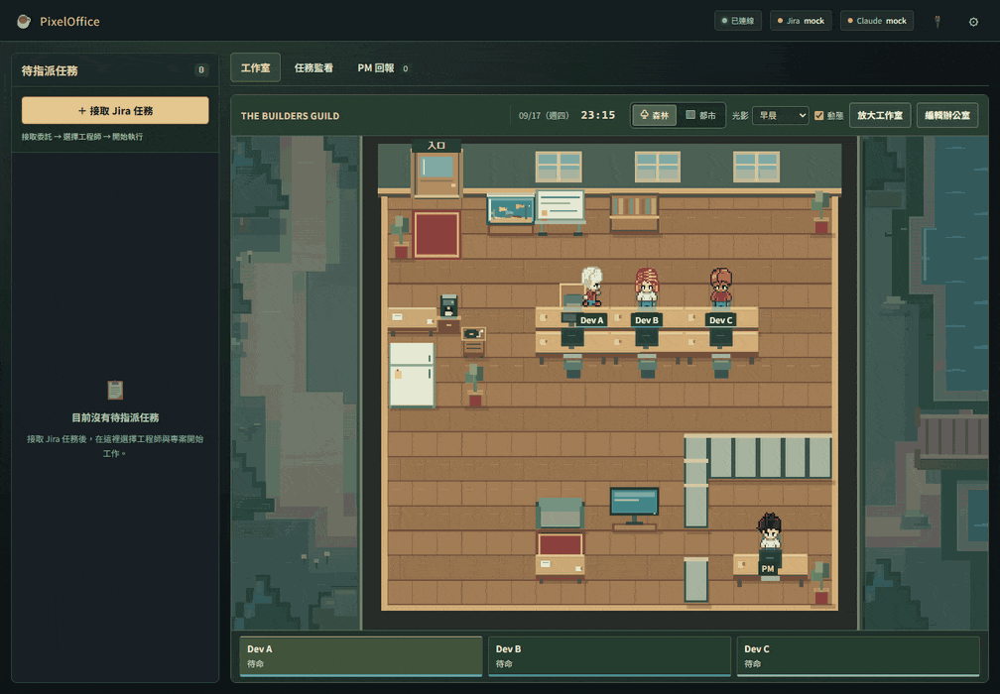
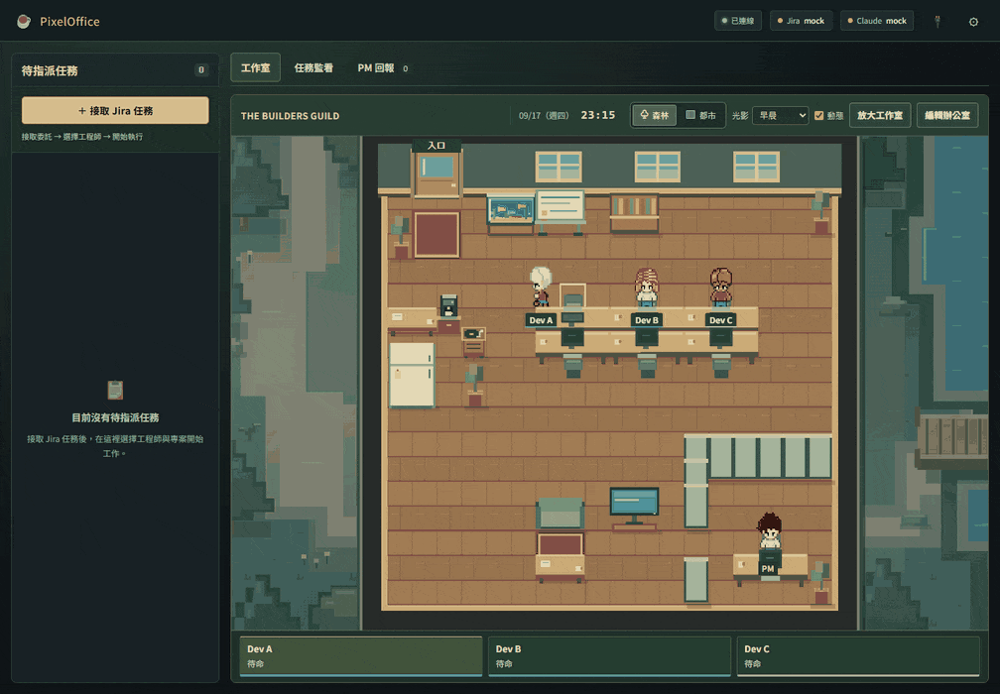
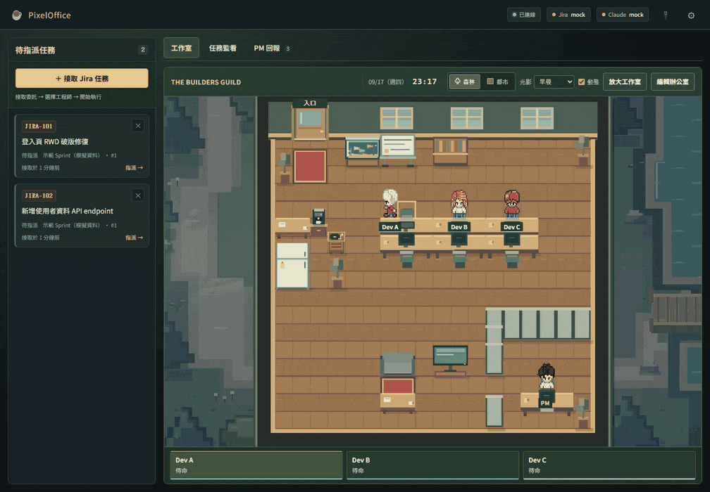
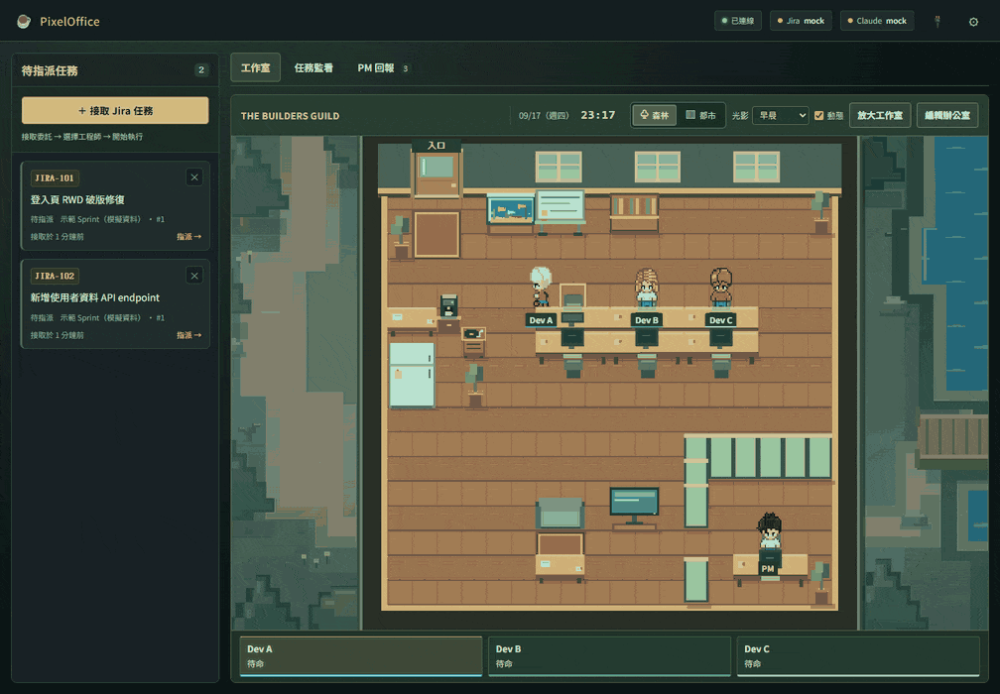

<div align="center">

# ☕ PixelOffice

### 你的 AI 團隊，終於有了自己的辦公室。

把 Jira 委託帶進像素辦公室，指派工程師、追蹤開發，親手驗收成果。<br>
從一張工單，到一個可以交付的改動——在你的本機展開。<br>
工作之餘，換個窗外風景，也別忘了餵餵水族箱裡的魚蝦。

**像素辦公室 · AI 團隊管理 · Claude Code / Codex · Jira 整合 · 互動水族箱 · 本機運行**

[🚀 開始體驗](#開始體驗) · [✨ 探索特色](#關於這間辦公室) · [🐠 水中花園](#水中花園) · [📖 完整使用手冊](docs/USER_GUIDE.md)



*實際介面錄製｜以下 GIF 使用內建 Mock 模式，任務資料為模擬，不代表真實 AI 開發或測試結果。*

</div>

<a id="關於這間辦公室"></a>

## ✨ 關於這間辦公室

**你負責決定下一個任務，讓 AI 工程師開始動手。**

PixelOffice 是一個帶有 RPG 氛圍的 AI 協作控制面板。PM 守在辦公室等候新委託，工程師待命時四處走動，開始工作便回到座位。角色背後連接的是本機開發流程：接取需求、執行 CLI、查看工具輸出，再由你確認成果。

有咖啡機、沙發和會游動的魚，也有任務看板、執行對話與變更檢視。讓每天的開發，多一點經營辦公室的樂趣。

新版介面讓辦公室成為視覺中心：寬螢幕左側保留待指派看板，上方可切換辦公室、任務追蹤與回報，並可開啟工作日誌。較窄的視窗則可透過「待指派」分頁接續操作。

## 📋 接下委託，帶領你的團隊

從 Jira 待辦清單批次接單，或直接輸入指定單號；也能切換到「開新單」整理新需求。接取後，選好工程師與專案，讓需求走進開發流程。



- **自己的 AI 班底**：預設三位工程師，可擴充至六位，自訂名稱與模型。
- **兩種 AI 平台**：在設定中選擇 Claude Code 或 OpenAI Codex，沿用各自 CLI 的登入與設定。
- **精簡開發原則**：工程師任務內建 Ponytail 提示，優先重用現有程式並控制改動範圍；詳見[使用手冊](docs/USER_GUIDE.md#ponytail-開發原則)。
- **多個專案同時推進**：不同工程師可處理不同專案；同一專案一次由一位工程師執行。
- **進度隨時掌握**：查看待指派、執行中與待驗收任務，點選角色即可進入對應任務。

## 🔎 不只看到忙碌，也能看懂成果

每位工程師都有獨立的任務對話。查看執行內容、工具呼叫與回傳，完成後檢查變更、送出修改意見，或標記驗收。

啟用自動開發後，任務會依設定走過：

**更新 develop → 建立任務分支 → 開發（工程師自行建置／測試）→ 成果報告 → 檔案檢視 → 人工交付**

工程師會依所選 AI 權限模式自行建置與測試。檢查成果時可產生 commit 訊息與 MR 內容草稿；是否按下 commit、還原或推送仍由你決定。詳細條件見[自動開發流程](docs/USER_GUIDE.md#分配後的自動開發流程)。

## 🌿 佈置一間你想待著的辦公室

工作有節奏，辦公室也有自己的時間。在森林與都市背景之間切換，讓光影跟隨本地時間，或停在你喜歡的早晨、中午、日落與夜晚。



換個名字、調整家具、旋轉桌椅，或重新鋪上地板。從魚缸、白板到唱片機，把辦公室佈置成自己的樣子。配置會保存在目前瀏覽器；編輯空間時，背景任務仍會繼續。

<a id="水中花園"></a>

## 🐠 工作之餘，照顧一座水中花園

點一下辦公室裡的魚缸，打開「魚蝦的水中花園」。蜜桃魚、檸檬魚、薄荷魚穿梭在水草間，櫻花蝦與玫瑰蝦則在缸底慢慢活動。點水面投下飼料，看魚兒追食、蝦子撿起沉底的飼料，讓等待任務的空檔多一點小樂趣。



- **🍽️ 點一下就能餵食**：點擊水族箱投下飼料；聚焦水族箱後，也可按 Enter 或空白鍵。
- **💧 每隻都有自己的飽足感**：每口恢復 25 點，每天消耗 50 點；低於 30% 就該補充飼料。
- **💾 延續你的飼養進度**：狀態保存在目前瀏覽器，關閉頁面後仍會依經過的時間扣除飽足感。歸零的魚蝦會死亡，無法再餵食，記得每天回來看看牠們。

<a id="開始體驗"></a>

## 🚀 開始體驗

需要 **Node.js 18 以上**（沒裝的話到 [nodejs.org](https://nodejs.org/) 下載 LTS 版，一路下一步即可）。

### 最簡單的方式：按兩下啟動

取得專案並解壓縮後：

| 系統 | 按兩下這個檔案 |
| --- | --- |
| Windows | `start.bat` |
| macOS | `start.command` |

啟動器會自動完成所有事：檢查 Node.js → 建立設定檔 `.env` → 第一次執行時安裝套件 → 啟動服務 → 開啟瀏覽器。

第一次啟動因為要安裝套件，會花幾分鐘，請不要關掉視窗；之後每次啟動都是幾秒鐘。
要關閉 PixelOffice，直接關掉那個黑色視窗即可。

預設帶的是 **模擬模式**（Jira、AI 都是假資料），不需要任何帳號或金鑰就能先逛一圈。

> macOS 第一次按兩下若出現「無法打開，因為來自未識別的開發者」，
> 請對檔案按右鍵 →「打開」→ 再按一次「打開」；或在終端機執行一次 `chmod +x start.command`。

### 想自己用指令啟動

```sh
npm install
npm start
```

設定檔請自行從範例複製一份：

```powershell
# Windows PowerShell
Copy-Item .env.example .env
```

```sh
# macOS / Linux
cp .env.example .env
```

想先逛逛辦公室，請在 `.env` 設為：

```dotenv
PIXEL_OFFICE_MODE=mock
```

接著開啟 **[localhost:3000](http://localhost:3000)**，接取第一張模擬委託。

### 準備讓團隊真正開工？

安裝並登入你要使用的 Claude Code 或 Codex CLI，完成 Atlassian MCP OAuth 授權，在設定中將全域執行模式切到 Real，再選擇 AI 權限模式。完整步驟與疑難排解收錄於[使用手冊](docs/USER_GUIDE.md)。

服務預設只允許本機存取，沒有內建登入驗證。Real 模式會在指定專案中執行開發工具；「完整存取」會解除 sandbox，只應用於可信任的專案與隔離環境。

## 📚 深入了解

| 想了解什麼 | 從這裡開始 |
| --- | --- |
| 安裝、平台設定、Jira 串接與日常操作 | [使用手冊](docs/USER_GUIDE.md) |
| 原始碼位置與修改入口 | [專案結構導覽](docs/PROJECT_STRUCTURE.md) |
| 場景、人物尋路、編輯器與 UI 實作 | [辦公室 UI 技術文件](docs/OFFICE_UI_TECHNICAL.md) |
| GIF 錄製方式與展示範圍 | [展示素材說明](docs/media/README.md) |

## 致謝

角色素材使用 JIK-A-4 的 [MetroCity - Free Top Down Character Pack](https://jik-a-4.itch.io/metrocity-free-topdown-character-pack)（CC0 1.0）。森林與都市背景為本專案自製。

---

<div align="center">

**下一張工單，就是辦公室的新委託。**

啟動 PixelOffice，讓你的 AI 團隊就位。

</div>
