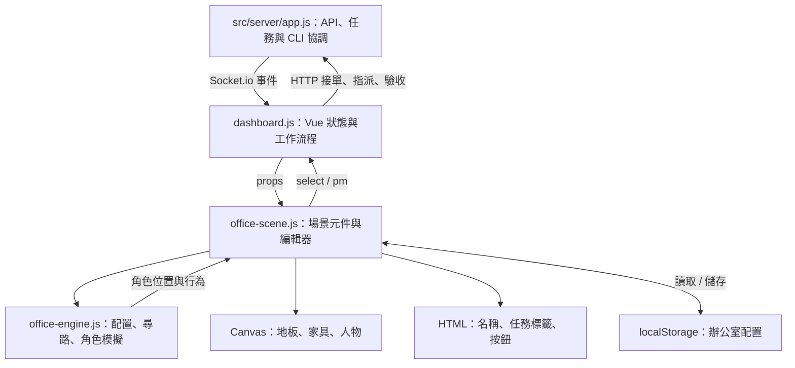
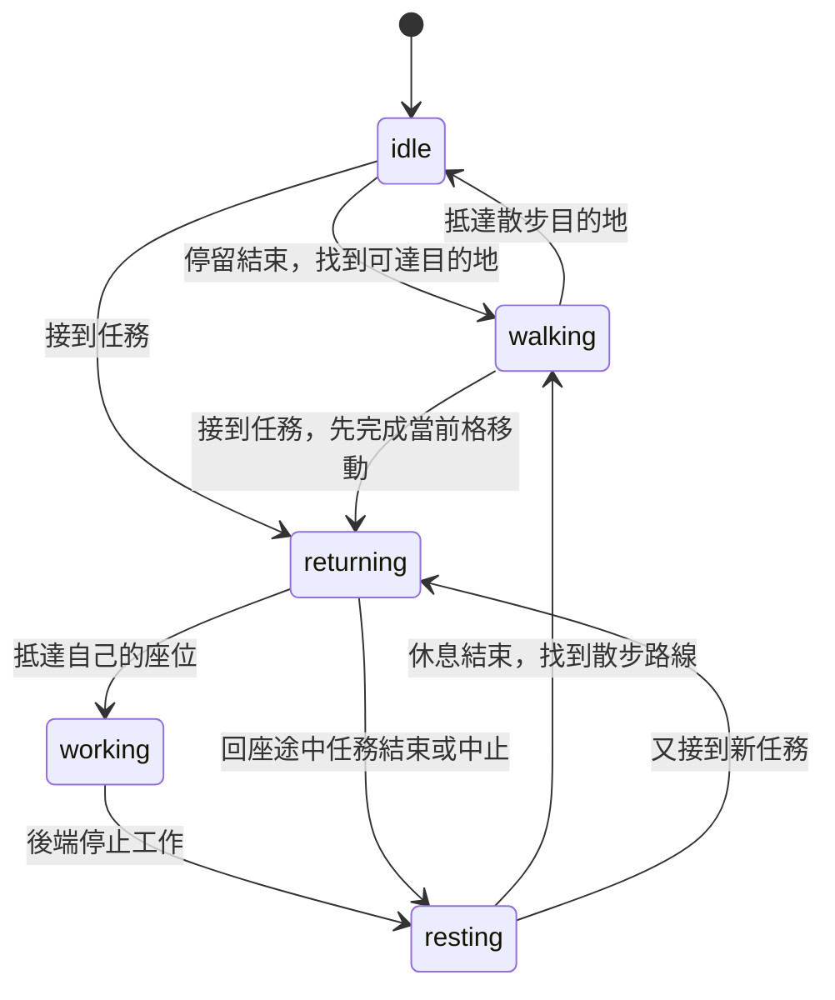

# PixelOffice：辦公室 UI 技術實作

這份文件說明專案目前如何把 AI 任務狀態呈現成可互動的像素辦公室，供後續維護、擴充家具與角色，以及調整版型時使用。

實作使用 Vue 3、Canvas 2D、CSS Grid／Flexbox 與 Socket.io，沒有額外導入遊戲引擎。辦公室模組負責視覺與互動；接單、派工、Claude Code／Codex 執行與驗收由 Dashboard 和 Node.js 後端處理。

## 1. 架構與檔案分工



| 檔案 | 職責 | 修改時優先找的入口 |
|---|---|---|
| [public/index.html](../public/index.html) | 主頁模板、彈窗與工作區標記 | 對應的 Vue 綁定 |
| [public/js/dashboard.js](../public/js/dashboard.js) | 任務資料、Socket.io 與工作流程狀態 | `mainView`、`inspectEngineer()` |
| [public/js/dashboard-ui.js](../public/js/dashboard-ui.js) | 頭像元件、工具摘要與終端輸出格式 | `PixelAgent`、`toolSummary()`、`stripAnsi()` |
| [public/js/dashboard-settings.js](../public/js/dashboard-settings.js) | 設定草稿、模型載入與儲存操作 | `createSettingsActions()` |
| [public/js/office-roles.js](../public/js/office-roles.js) | 角色登記表：PM／BOSS 的預設名稱、外觀、專屬桌，以及外觀格式檢查；瀏覽器、引擎與伺服器共用 | `ROLES`、`HAIR_COLORS`、`ACCESSORIES`、`roleName()`、`roleLook()`、`normalizeLook()`、`cleanRoles()` |
| [public/js/office-sprites.js](../public/js/office-sprites.js) | 依外觀畫出角色：三層貼圖、髮色重新上色、配件像素；場景、外觀預覽與任務分頁頭像共用 | `load()`、`paint()` |
| [public/js/office-engine.js](../public/js/office-engine.js) | 純邏輯模組，可在瀏覽器和 Node.js 使用 | `Simulation`、`path()`、`validate()`、`appearance()` |
| [public/js/office-scene.js](../public/js/office-scene.js) | Vue 場景元件、動畫迴圈、Canvas 繪製、配置編輯 | `mounted()`、`draw()`、`clickScene()`、`saveEdit()` |
| [public/css/office.css](../public/css/office.css) | 辦公室配色、舊場景樣式、共用 CSS 人物頭像 | `.pixel-agent`、`.sprite-layer`、`.portrait` |
| [public/css/office-scene.css](../public/css/office-scene.css) | 場景工具列、角色列表、編輯器基礎樣式 | `.scene-*` |
| [public/css/dashboard-layout.css](../public/css/dashboard-layout.css) | 最終版型、響應式高度、場景縮放容器、清晰文字層 | `.layout`、`.scene-viewport`、`.world-*` |
| [public/pages/character-check.html](../public/pages/character-check.html) | 角色完整服裝與四方向影格檢查頁 | 九組搭配、216 個影格 |
| [test/office-engine.test.cjs](../test/office-engine.test.cjs) | 邏輯回歸測試 | Node 內建 `node:test` |
| [src/server/app.js](../src/server/app.js) | Express 靜態資源、API、Socket.io 和任務協調 | `/assets/MetroCity`、`engineers:update`、`task:*` |

### 載入順序

前端先載入 Vue、Socket.io，再依序載入 `office-roles.js`、`office-engine.js`、`office-sprites.js`、`office-scene.js`、`task-status.js`、`dashboard-ui.js`、`dashboard-settings.js`，最後執行 `dashboard.js` 的 Vue 應用程式。角色登記表、引擎、角色繪製、場景元件、顯示工具與設定操作分別公開為 `window.OfficeRoles`、`window.OfficeEngine`、`window.OfficeSprites`、`window.OfficeScene`、`window.DashboardUI`、`window.DashboardSettings`。

CSS 依序載入 `dashboard.css`、`office.css`、`office-scene.css`、`dashboard-layout.css`、`startup.css`。後載入的版型規則可能覆寫較早的同名選擇器，調整尺寸時應檢查實際套用結果。

## 2. 頁面版型：保護主要工作流程

原先把辦公室和看板放在同一個垂直欄位。場景高度隨工程師數量或編輯工具列增加，會壓縮甚至擠掉下方看板。

目前改成固定視窗工作區：

| 螢幕 | 版型 |
|---|---|
| 寬度至少 960px | 左側固定看板；右側使用辦公室、任務追蹤、回報分頁，另有開啟工作日誌視窗的「工作日誌」按鈕 |
| 寬度小於 960px | 單欄工作區；導覽增加「待指派」分頁，每次顯示一個完整面板 |
| 寬度至少 1500px | 左側看板由 300px 加寬至 340px |

桌面 Grid 的概念如下，實際數值與媒體查詢以 `dashboard-layout.css` 為準：

```css
#app {
  height: 100vh;
  height: 100dvh;
  display: flex;
  flex-direction: column;
  overflow: hidden;
}

.layout {
  flex: 1;
  min-height: 0;
  grid-template-columns: 300px minmax(0, 1fr);
  grid-template-rows: 48px minmax(0, 1fr);
}
```

`min-height: 0` 允許 Grid／Flex 子元素縮小到剩餘空間；`minmax(0, 1fr)` 防止內容的最小尺寸反過來撐大欄位。看板清單、任務對話、回報列表各有捲動容器，辦公室則完整縮放至可用空間。

任務驗收內容可能很長，因此任務面板本體允許垂直捲動，對話區保留至少 280px 的空間。編輯辦公室時暫時隱藏場景底部角色列表和 PM 摘要，把空間交給工具與場景；後端任務仍持續執行。

### 工作區切換

`mainView` 有四種值：`studio`、`queue`、`tasks`、`reports`。

| 操作 | 前端行為 |
|---|---|
| 接取 Jira 任務成功 | 設為 `queue`；手機直接看到看板，桌面看板持續顯示 |
| 指派成功 | `inspectEngineer(id)` 設為 `tasks`，再切換該工程師分頁 |
| 點選場景角色或工作桌 | 同樣呼叫 `inspectEngineer(id)` |
| 點選 PM、BOSS 或 BOSS 辦公桌 | 場景發出 `role-action` 事件，帶角色在 `office-roles.js` 設定的 `action`（PM 為 `claim`、BOSS 為 `worklog`）；主頁的 `runRoleAction()` 依對照表開啟接單彈窗或工作日誌 |
| 點選任務追蹤／回報 | 顯示對應面板；依原有自動捲動設定恢復閱讀位置 |

辦公室、任務、回報使用 `v-show` 保留元件，切換不會重建模擬器或清掉編輯草稿。小螢幕的看板可見性另外由 `data-view` 對應的 CSS 控制。

## 3. 三種座標：格子、邏輯像素、畫面像素

這三種座標必須分開，才能同時支援尋路、像素繪圖和任意視窗大小。

| 座標 | 用途 | 範例 |
|---|---|---|
| 格子座標 | 尋路、家具位置、座位與碰撞 | `{x: 4, y: 7}` |
| Canvas 邏輯像素 | 精靈與家具繪圖 | 每格 32px，場景寬 `20 × 32 = 640px` |
| 畫面像素 | 使用者看到的 DOM 尺寸與滑鼠位置 | 邏輯像素乘上 `sceneScale` |

引擎固定 `COLS = 20`、`CELL = 32`。預設房間列數為：

```js
rows = Math.max(18, 12 + Math.ceil(engineerCount / 3) * 4);
```

每排三張工作桌，桌子左上角按下式安排：

```js
x = 7 + (index % 3) * 4;
y = 6 + Math.floor(index / 3) * 4;
```

可行走範圍排除左右外牆、上方裝飾牆以及最底列。PM、BOSS 等角色的位置統一由 `rolePosition(layout, id)` 從該角色的專屬桌（`office-roles.js` 的 `deskType`）推導，椅子、標籤、命中區與碰撞共用該座標。水平桌時位於桌子 `(x+1,y-1)`，垂直桌時位於 `(x-1,y+1)`；沒有桌子時使用角色的 `fallbackSeat`（PM 為 `(3,3)`），`fallbackSeat: null` 的角色（BOSS）則不出現。

`validate()` 對每個角色套用同一組規則：專屬桌最多一張、座位在室內、角色之間不共用座位、家具不占用任何角色座位。標記 `aisle: true` 的角色（PM）旁邊那一格是主走道，由 `aisleEntry(layout)` 取得，驗證會從這裡檢查每張工作桌的回座路線。錯誤訊息使用自訂後的角色名稱。

## 4. 完整顯示場景，不依靠捲動

`ResizeObserver` 監看 `.scene-viewport`，取得扣除工具列、角色列表等介面後真正剩下的寬度與高度：

```js
sceneScale = Math.min(
  viewportWidth / 640,
  viewportHeight / worldHeight
);

displayWidth = 640 * sceneScale;
displayHeight = worldHeight * sceneScale;
```

`.scene-world` 使用這個實際顯示尺寸，Canvas 的 CSS 寬高填滿 world。Canvas 自身的 `width`、`height` 仍是邏輯尺寸，縮放不會改變碰撞地圖與角色路徑。

容器使用 Grid 置中且隱藏溢位。長寬比不同時會有留白，這是保留完整場景與正確比例的結果。工程師增加、工具列打開、視窗改變大小時，比例都會重新計算。分頁隱藏時觀察器可能回報零尺寸，因此程式忽略零值，等面板重新顯示後再更新。

### 縮放後的點擊換算

不能直接用 `clientX / 32` 找格子，因為 `clientX` 是整個視窗的座標，且場景可能已縮小。

`clickScene()` 先轉回 Canvas 邏輯像素，再轉成格子：

```js
const rect = canvas.getBoundingClientRect();
const x = (event.clientX - rect.left) * canvas.width / rect.width;
const y = (event.clientY - rect.top) * canvas.height / rect.height;

const tile = {
  x: Math.floor(x / 32),
  y: Math.floor(y / 32)
};
```

人物點選使用邏輯像素命中範圍；家具選取使用 `cells(furniture)` 的格子範圍。兩者都沿用同一次座標還原，因此縮放後不必另寫一套互動邏輯。

## 5. Canvas 畫美術，HTML 畫文字

家具和人物適合像素化呈現；姓名與中文任務標籤需要文字可讀性。目前採用混合渲染：

| 層 | 內容 | 呈現方式 |
|---|---|---|
| Canvas | 地板、牆面、窗戶、桌椅、盆栽、人物 | `imageSmoothingEnabled = false`、`image-rendering: pixelated` |
| HTML 疊加層 | 人物名稱、工單標籤、PM 與招牌文字 | 絕對定位，獨立字級 |
| 一般 Vue UI | 分頁、狀態、編輯工具、PM 摘要 | 標準 HTML 元素與 CSS |

每幀產生 `labels`，把邏輯座標乘上縮放比例，直接設定 DOM 的 `left`／`top`。文字元素本身沒有跟著整個 world 做 `transform: scale(...)`，所以字級不會隨房間等比例縮到難以閱讀。縮得較小時，人名改用 11px 並隱藏重複的場景招牌；外層辦公室標題仍保留。

疊加文字使用 `pointer-events: none`，讓滑鼠事件穿透到 Canvas。角色列表提供真正的按鈕，使用者也可以不點畫布就選擇工程師。

### 繪製順序與遮擋

`draw()` 先畫地板與牆，再畫地毯、椅子，接著把家具與人物依底部位置排序：

```js
furnitureDepth = (furniture.y + furnitureHeightInCells) * 32;
characterDepth = (character.y + 1) * 32;
```

深度較小的先畫，較大的後畫，建立角色走在家具前後的效果。名稱與工單標籤位於最上方的 HTML 層，不參與家具深度排序。

家具目前以 Canvas 矩形和色塊繪製，不依賴外部家具圖包。畫出的裝飾邊緣或高度可以超出占用格子；尋路碰撞仍以格子範圍為準。

## 6. 人物素材與服裝組合

人物素材位於 `assets/characters/MetroCity`，由 Express 對外提供 `/assets/MetroCity` 靜態路徑。角色由三張貼圖依序疊合：身體、服裝、髮型。

| 貼圖 | 尺寸 | 排列 |
|---|---|---|
| `CharacterModel/Character Model.png` | 768 × 192 | 24 欄、6 種身體外觀列 |
| `Outfits/Outfit5.png`、`Outfit6.png` | 768 × 32 | 同樣 24 欄 |
| `Hair/Hairs.png` | 768 × 256 | 24 欄、8 種髮型列 |

每一格都是 32 × 32；四個方向各六個影格：

| direction | 朝向 | 欄位 |
|---|---|---|
| 0 | 下／正面 | 0～5 |
| 1 | 右 | 6～11 |
| 2 | 上／背面 | 12～17 |
| 3 | 左 | 18～23 |

移動時以每秒約八次影格切換播放，停止時使用該方向第一格：

```js
frame = direction * 6 + (moving ? Math.floor(time * 8) % 6 : 0);
sourceX = frame * 32;
sourceY = appearanceRow * 32;
```

`drawImage()` 將三層相同欄位的 32px 影格畫成邏輯尺寸 64px，確保衣服跟著身體一起走動。

### 為什麼只使用 Outfit5、Outfit6

Outfit1～4 不是可直接套用的完整上下身服裝。先前把六張貼圖輪替成「整套衣服」，會造成部分角色缺上衣或下身。

現在統一由 `OfficeEngine.appearance()` 回傳：

```js
{
  skin: index % 6,
  hair: index % 8,
  outfit: isPM ? 5 : [5, 6][index % 2]
}
```

工程師沒有自訂外觀時使用名單索引加一。PM／BOSS 的預設外觀、名稱寫在 `office-roles.js` 的 `ROLES`，BOSS 的領帶是配件 `accessories: ['tie']`，不再是角色專屬判斷。

外觀可以自訂，格式為：

```js
{skin: 0–5, hair: 0–7, outfit: 5|6, hairColor: ''|'black'|'brown'|'blonde'|'red'|'silver'|'blue'|'pink'|'green', accessories: ['tie', 'glasses', 'headphones'] 的任意組合}
```

`hairColor` 空字串保留素材原色；其他顏色由 `office-sprites.js` 把髮型圖逐列重新上色，保留原本的明暗層次。配件的像素座標依四個方向分別定義在同一檔的 `ART`，例如領帶只在正面出現。舊格式的單一 `accessory: 'tie'` 讀取時會自動轉成 `accessories: ['tie']`。

- 工程師：`config/engineers.json` 每位工程師的 `look` 欄位。從設定畫面儲存名單時會保留原本的 `look`。
- PM／BOSS：`config/roles.json` 的 `roles.pm`、`roles.boss`，可存 `name`（最多 12 字）與 `look`，透過 `GET/PUT /api/roles` 讀寫，儲存後以 Socket.io `roles:update` 推送給所有畫面。舊版存在瀏覽器配置裡的 `roles` 會在載入時自動搬到伺服器（伺服器已有設定時不覆蓋），並從瀏覽器配置移除。
- 自訂的 PM 名稱也用於回報分頁的空白提示、放棄任務的提示，以及伺服器主控台的 `[PM]` 標籤。分頁標題固定為「回報」。

格式不正確或省略時一律退回自動／預設外觀。

「編輯辦公室」的「角色外觀」可選任一角色，用膚色、髮型、服裝、髮色選單與配件勾選框，或「隨機」調整，右側預覽畫出正面、右側、背面、左側四個方向的走路動作，「恢復預設」則清除自訂。按「儲存配置」後：PM／BOSS 的名稱與外觀寫入 `roles.json`；工程師外觀透過 `PUT /api/engineers/:id/look`（`look: null` 為清除）寫入 `engineers.json`，所有連線的畫面都會更新。

### 角色登記表欄位

`office-roles.js` 的 `ROLES` 每筆描述一個特殊角色，場景的名片、下方按鈕、點擊、椅子與人物都依這份表產生：

| 欄位 | 用途 |
|---|---|
| `name`、`look` | 預設名稱與外觀，可被配置的 `roles.<id>` 覆蓋 |
| `deskType` | 專屬桌的家具類型，座位由它推導 |
| `fallbackSeat`、`aisle` | 沒有桌子時的座位；是否為主走道所在角色（見座位說明） |
| `action`、`clickDesk` | 點選角色時請主頁開啟的功能；是否連點專屬桌也觸發 |
| `chair` | 椅子畫法：`office` 或 `executive` |
| `labelColor` | 名片文字顏色，空字串用預設米白 |
| `roster` | 下方角色列的按鈕 `{hint, color}`，`null` 表示不顯示 |

新增角色時：在 `ROLES` 加一筆、在 `office-engine.js` 的 `TYPES` 加上它的桌子類型並補上桌子畫法，再到 `dashboard.js` 的 `ROLE_ACTIONS` 接上功能。新增服裝時，必須確認全部 24 個影格都有完整上下身，或另設明確的上衣／褲子分層，不能單純擴大輪替範圍。

目前沒有獨立的坐姿、閱讀、打字動作圖集。工作效果是角色抵達座位後朝向桌面，搭配小幅手部色塊和螢幕程式碼閃動；若要更完整的坐姿動畫，需要再補動作素材與渲染分支。

## 7. 尋路、移動與行為狀態機

`Simulation` 不依賴 DOM、Vue 或 Canvas，只處理資料。這讓尋路與回座流程可以在 Node.js 測試，不必啟動瀏覽器。

### 角色主要欄位

| 欄位 | 意義 |
|---|---|
| `cell` | 最近到達的整數格子 |
| `x`、`y` | 正在移動時的浮點格子位置，用於繪圖 |
| `next` | 正在前往且已預約的相鄰格子 |
| `route` | 後續格子的陣列 |
| `home`、`desk` | 專屬座位與工作桌 |
| `working` | 後端工程師是否有工作，或試演覆寫後的值 |
| `mode` | 動畫行為：idle、walking、returning、working、resting |
| `timer` | 停留、休息或重試前的等待秒數 |
| `direction` | 四方向影格索引 |

### 狀態轉換



首次載入已在工作的工程師會直接出現在自己的座位。這是還原目前工作狀態；瀏覽器沒有保存重新整理前的人物位置，不會重播那段回座過程。

### BFS 尋路

`path(layout, start, goal, extra)` 使用廣度優先搜尋（BFS），只允許上下左右四個相鄰格子。所有格子的移動成本相同，因此可找出當下可行的最短格子路徑，不需要 A* 的啟發式估算。

- 靜態障礙由 `blocked(layout)` 建立：PM 與所有非地毯家具。
- 動態障礙透過 `extra` 傳入其他角色占用的格子。
- 回傳路徑不包含起點；起終點相同回傳空陣列，無路可走回傳 `null`。
- 搜尋成本隨可探索格子數增加；目前地圖固定 20 欄，適合使用簡單 BFS。

### 防止穿牆、重疊與漂移

每次移動只在一條水平或垂直邊上內插，速度約為每秒 2.1 格。一步的位移限制為剩餘距離，抵達後再把 `cell` 更新成整數座標。

其他角色的 `cell` 和 `next` 都視為占用，避免兩個人同時進入一格或迎面交換位置。如果下一格被占用，就清掉舊路徑，等待約 0.4～0.9 秒後重試。

接單時只清除後續 `route`，保留進行中的 `next`，先走完當前一格再改道，因此不會瞬移到座位或突然斜向滑動。

待命散步的目的地從座位附近水平約 ±5 格、垂直約 ±3 格的範圍抽取，最多嘗試 30 次；散步路徑避開所有人的座位。到達後停留約 2～6 秒，再挑選下一個目的地。任務結束後休息約 2.5 秒再開始離座。

### 動畫迴圈與清理

場景用 `requestAnimationFrame` 計算時間差，再呼叫 `sim.step(dt)`。時間差最多採計 0.1 秒，避免背景停頓後一次跳過很長距離。

- 編輯模式、斷線或文件在背景時，不推進一般模擬；試演可在斷線時繼續。
- `visible` 控制是否繪製場景；切到其他工作區不重建引擎。
- 減少動態效果模式不再啟動新的待命散步，也不播放走路影格與螢幕閃動；已存在的移動路徑及必要回座仍可能繼續。
- 元件卸載時取消 RAF，斷開 ResizeObserver，移除媒體查詢監聽器。

## 8. 任務狀態與動畫狀態分開

`walking`、`returning`、`resting` 只用來決定角色如何動，不直接當成使用者需要閱讀的狀態。

主頁的 `agentStatuses` 結合工程師狀態與最近一筆任務資料，產生以下標籤：

| 判斷 | 使用者看到的狀態 |
|---|---|
| 工程師 `status === working` | 執行中 |
| 工程師已待命，最近任務是 `done` | 待驗收 |
| 最近任務是 `failed` | 執行失敗 |
| 最近任務是 `aborted` | 已中止 |
| 沒有上述狀況，包含已驗收 | 待命 |
| 場景連線中斷 | 連線中斷 |

因此工程師即使正在回座，仍顯示「執行中」；完成後離座散步，仍可顯示「待驗收」。移動動畫不會延遲後端 Claude 的真正啟動，後端也不會等角色坐好才執行任務。

### Socket.io 資料流

| 事件 | 前端處理 |
|---|---|
| `engineers:update` | 更新工程師集合，場景的深層 watcher 呼叫 `syncRoster()`，再同步至 `Simulation.sync()` |
| `board:update` | 更新待指派任務 |
| `task:started`、`task:history` | 建立／還原任務資料並排序 |
| `task:event`、`task:events` | 更新或還原執行對話 |
| `task:finished`、`task:accepted` | 更新結束／驗收狀態，主頁重新計算重要標籤 |
| `pm:history`、`pm:message` | 更新 PM 訊息列表和場景摘要 |

### 動畫試演

`currentEngineers()` 只對選定工程師建立一份狀態覆寫，不修改父元件工程師資料，也不呼叫任務 API。試演按鈕可模擬接單、完成，角色列表會明確加上「試演」字樣。

工程師開始真正工作或被移除時，會結束該角色的試演並恢復後端狀態。維護時應保留這條界線，避免使用者為了看動畫而意外啟動 Claude。

## 9. 辦公室編輯器與儲存

### 配置結構

以下是一個可描述單一工位的最小範例；實際預設配置還包含其他家具。

```json
{
  "version": 1,
  "cols": 20,
  "rows": 14,
  "floor": "wood",
  "furniture": [
    {
      "id": "desk:devA",
      "agentId": "devA",
      "type": "desk",
      "x": 3,
      "y": 6,
      "rotation": 0
    }
  ]
}
```

| 家具類型 | 未旋轉占用大小 | 可穿越 |
|---|---|---|
| `desk`、`pmdesk` | 3 × 1 格 | 否 |
| `meetingtable` | 3 × 2 格 | 否 |
| `shelf`、`sofa`、`aquarium`、`table`、`whiteboard`、`tv`、`window` | 2 × 1 格 | 否 |
| `plant`、`wall`、`coffee`、`recordplayer`、`filingcabinet`、`printer`、`watercooler` | 1 × 1 格 | 否 |
| `fridge` | 2 × 2 格 | 否 |
| `rug` | 2 × 2 格 | 是 |
| `bossdesk` | 3 × 1 格 | 否 |
| `carpet` | 3 × 2 格 | 是 |
| `trophycase`、`globe`、`safe` | 1 × 1 格 | 否 |

預設配置採每排三個中央工位，六位時形成兩排。左上為入口與迎賓地毯，旁邊放水族箱；左中為咖啡機、邊桌與冰箱。中央下方安排沙發、地毯與茶几；右下為 PM 獨立辦公室，隔間左側保留兩格門口。PM 工位及隔間隨房間高度配置，人物仍由 pmPosition 推導。左下為 BOSS 獨立辦公室（`bossSuite()`），與 PM 室對稱、門口在右側，內含高級地毯、主管桌、獎盃櫃、書櫃、地球儀、保險箱與盆栽；BOSS 由 `bossPosition()` 從 `bossdesk` 推導，座位同樣列入碰撞，刪除主管桌後 BOSS 不會出現。點 BOSS、主管桌或角色列的「BOSS · 工作日誌」會發出 `boss` 事件開啟工作日誌。舊配置由 `reconcile()` 依 `bossVersion` 補一次：整套放得下才加整套，否則只把主管桌放在第一個空位，不動使用者擺好的家具。套用預設配置會保留辦公室名稱。

魚缸使用 Canvas 色塊繪製游魚與氣泡，以模擬時間驅動動畫；減少動態偏好會固定畫面。家具工具列由 `LABELS` 產生，新增類型後也能在編輯器新增、移動、旋轉及保存。編輯器以 Q 左轉、R 右轉；沙發與冰箱支援四個朝向（冰箱為正面、門朝左、背面、門朝右，占用固定 2 × 2），其他可旋轉家具維持兩種占用方向。

已有 localStorage 配置不會自動被新版預設覆蓋。使用者可透過「編輯辦公室 → 預設配置」預覽，按「儲存配置」套用，或取消保留原配置。

`rotation` 只有 0 和 1，代表交換寬高的兩種方向，不是任意角度旋轉。工作桌透過 `agentId` 綁定工程師；座位都是桌子原點加 `(1, 1)`：水平桌時位於下方，垂直桌時位於右側。椅子依座位繪製，沒有獨立配置項目。

### 草稿、驗證與提交

編輯器的「辦公室名稱」最多 30 個字元，以可選的 `layout.name` 欄位隨配置保存，舊配置仍可讀取。工具列與室內招牌同步顯示名稱；取消編輯會還原，空白名稱儲存時使用 THE BUILDERS GUILD。長名稱以省略號呈現，避免擠壓工具列。

1. `beginEdit()` 深拷貝現有配置到 `draft`，停止人物模擬。
2. 選取家具後點目的格移動，或聚焦 Canvas 用方向鍵；R 旋轉，Delete／Backspace 刪除，Esc 取消選取。
3. 每次操作先建立下一份配置，再交給 `changeDraft()` 驗證。
4. 有效才取代草稿，並把舊版本推入 `undoStack`，最多保留 30 次。
5. 取消則丟棄草稿；儲存時再次驗證並寫入 localStorage。
6. 成功後以新配置重建 `Simulation`，角色重新出現在各自座位，再依工程師狀態繼續動作。

編輯期間後端仍可能有任務進度；儲存後必須重新同步最新工程師資料。若工程師名單在編輯中改變，現行行為是退出編輯並通知使用者，未儲存草稿不會自動合併。

### 驗證內容

`validate(layout, engineerIds)` 檢查版本、20 欄、14～200 列、最多 500 件家具、合法類型、唯一 ID、整數位置和旋轉值。

非地毯家具不能重疊、越界或占用 PM；主走道、座位必須保持空間。每位工程師要有獨立工作桌，且從 PM 旁的進出格能尋路到每個座位。已指派工程師的工作桌可以移動、旋轉，但不能直接刪除。

地毯不阻擋行走，也允許在家具下方，因此不能用「任何格子重疊都拒絕」的單一規則處理所有家具。

### 保存與工程師名單變動

配置使用 localStorage key：`rpg-office-layout-v1`。

- 以 origin 區分；`localhost:3000`、`localhost:3100`、`127.0.0.1:3100` 不共享同一份配置。
- 不會回寫到 `config/projects.json`、`config/engineers.json` 或伺服器上的辦公室設定檔。
- 儲存失敗會保留草稿並顯示訊息，不能先關閉編輯器再假定成功。
- `reconcile()` 盡量保留有效配置，刪除已不存在工程師的工作桌，替新工程師在新增列配置座位。
- 無效或不相容的已存配置會退回預設房間；目前沒有跨版本遷移器。

## 10. 如何擴充

### 新增家具

先在引擎的 `TYPES` 加入類型，定義 `size()` 的占用尺寸和是否阻擋行走，再加入 `drawFurniture()` 的繪製分支、編輯工具列與家具名稱。若家具會影響座位，還要調整 `seat()` 或新增座位描述。

驗證至少包含放在邊界、與其他家具重疊、堵住座位、旋轉後尺寸，以及重新載入配置。視覺大小與格子占用應一起設計，否則會出現人物看起來穿過大型家具的情況。

### 新增人物或動作

沿用目前 32px 格子和四方向六影格格式時，先擴充資源載入，再修改 `appearance()` 與素材檢查頁。改用不同圖集規格時，須同步更新 Canvas 裁切公式和 `PixelAgent` 的 CSS 背景大小／位置。

新增坐姿、閱讀或打字圖集時，依 `mode` 選擇素材與影格，不要把所有動作都塞到走路影格中。若需要不同工具觸發不同動作，還需從任務事件中建立活動資訊，目前 `working` 本身沒有這種細分。

### 新增重要狀態

先定義後端狀態或任務事件，再調整主頁的 `agentStatuses`、場景的 `statusLabel()` 和任務頁的狀態呈現。只有真的需要不同人物行為時才修改 `Simulation`。例如「等待使用者輸入」需要可靠的資料來源，不能從角色站著不動推斷。

## 11. 測試與人工驗證

執行既有邏輯測試：

```sh
node --test test/office-engine.test.cjs
node --check public/js/office-engine.js
node --check public/js/office-scene.js
```

目前十項測試覆蓋 PM 工位移動與旋轉、完整套裝選用、不同人數與名單增減、四方向尋路、家具／座位驗證、接單回座與完成離座、多角色占用、減少動態、多人同時回座，以及移動途中連續狀態切換。

測試以固定亂數和可控制的 `step(.05)` 推進時間，讓散步和回座可重現，不依賴真實等待。

### 瀏覽器驗證清單

| 情境 | 檢查重點 |
|---|---|
| 桌面、1280 × 720、390 × 844 | 整個辦公室都在 scene viewport 內；看板入口、底部操作沒有被裁掉 |
| 開啟編輯器、調整視窗、切回辦公室 | ResizeObserver 重新計算；沒有使用隱藏分頁的零尺寸 |
| 縮放後點選邊緣家具 | 選到正確格子；取消編輯不改動原配置 |
| 接取 → 指派 → 執行 → 驗收 | 看板和任務頁導引正確，回報與重要狀態同步 |
| 散步途中接單、途中完成／中止 | 角色不瞬移、不斜滑；最終狀態正確 |
| 改地板／搬桌子後儲存並重新整理 | 同 origin 還原配置；座位仍可達 |
| `/character-check.html` | 上衣、褲裝、髮型在四方向與全部行走影格對位 |

端到端驗證建議用獨立 mock 服務：設定 `PIXEL_OFFICE_MODE=mock`，並用 `TASK_DIR`、`RUNTIME_CONFIG`、`PROJECTS_CONFIG`、`ENGINEERS_CONFIG` 指向測試用目錄與設定，避免把測試工單混入正在使用的工作區。

### 常見問題定位

| 問題 | 優先檢查 |
|---|---|
| 看板又被擠到畫面外 | CSS 載入順序、Grid／Flex 的 `min-height: 0`、是否恢復了固定最小頁面高度 |
| 場景下半部被裁切 | ResizeObserver 監看的元素、`worldHeight`、是否同時按寬和高取最小比例 |
| 人名模糊 | 是否把 HTML 文字改回 Canvas，或對包含文字的容器套用了整體縮放 |
| 點選位置偏移 | 是否先扣 Canvas 左上角，再換回邏輯尺寸 |
| 角色缺衣物或衣服亂跳 | 是否選用了局部衣物，三層是否使用同一個 frame |
| 角色無法回座 | `agentId` 是否對應、座位是否被占用、靜態／動態障礙與路徑是否一致 |
| 編輯配置沒有保留 | origin 是否相同、localStorage 是否可用、配置是否通過 `validate()` |

## 12. 現有範圍與限制

本版已提供工作流程面板、可編輯場景、四方向散步、回座、工作效果、配置保存與自動完整縮放。以下事項尚未實作，不應從目前 UI 推斷為已支援：

- 伺服器端或多人共享的辦公室配置，以及多分頁即時同步編輯。
- 人物外觀按工程師 ID 永久綁定；目前依排序後的名單索引搭配，排序改變可能換外觀。
- 人物行走位置的持久化；儲存房間、重新整理或重建名單時會重新安置人物。
- 獨立坐姿／打字／閱讀動作圖集，以及按工具種類顯示工作動畫。
- 對任意狹窄配置保證無阻塞的多人協同尋路；現行預約與重試避免占用重疊，但不是完整的多人排程演算法。
- 大量角色的渲染與效能最佳化；房間增長時完整適應面板會使美術變小，這是全景可見與細節尺寸之間的取捨。

後續若導入更多家具、跨裝置保存或大型辦公室，應優先保留三個分界：後端任務是真實狀態來源、引擎只管模擬邏輯、Canvas 與 HTML 各自負責美術和可讀資訊。


### 工作總覽與場景放大

`overviewFilter` 決定總覽清單，`done` 對應待驗收，`failed` 與 `aborted` 對應需處理。開啟任務時先設定 `selectCard[engineerId]`，再切換工程師，確保開的是指定執行紀錄。接單以既有清單與單號視窗搭配相同切換列，兩者互斥顯示，入口直接呼叫 `openClaim()`。

### 工程師上限、任務整理與操作核准

工程師設定最多 6 位，前端停用新增且後端再次驗證。整理已結束任務由 `/api/tasks/clear-finished` 保存狀態：失敗退回 backlog、accepted 封存、done 保留待驗收。`task:requeued` 同步移除已退回的舊卡片，事件檔不刪除。

派工提交 `branchMode` 與 `branchName`；手動模式只在核准後確認當前分支。自動開發 runner 先確認工作區乾淨，再依序 checkout 基底分支（預設 develop）、`pull --ff-only origin <base>`、記錄 base commit 並建立新任務分支；任一步失敗都不啟動工程師。成果頁的 Git 操作仍經 `ApprovalGate`。AI 工具權限改由全域 `accessMode` 控制：`ask` 使用 PixelOffice 核准面板，`auto` 使用 Claude `auto` 或 Codex `auto_review` 並保留工作區 sandbox，`full` 使用 Claude `bypassPermissions` 或 Codex `danger-full-access + never`。專案不再維護 shell 命令白名單。

### 可配置窗戶

`window` 是獨立牆面物件，占 2×1 格，固定 y=1、rotation=0，x 範圍 5～17。驗證使用獨立的窗戶占用集合，避免彼此重疊或蓋住入口；不加入地板碰撞。背景繪圖改讀取 furniture 中的窗戶，編輯器沿用新增、移動、刪除、復原與保存流程。`windowVersion: 1` 標記轉換完成，舊配置在 reconcile 中補上原本三扇窗戶；標記保留時，零扇窗戶也是有效的使用者配置。

### 工程師擴充工具實作

`src/server/features/engineer-actions.js` 註冊每位工程師的 `POST /api/engineers/:id/actions`。操作驗證任務所屬工程師、專案鎖與分支；finally 釋放鎖，避免失敗後卡住。

前端在任務結束後提供「檢查成果」入口，依序呈現成果報告、Git short-status 檔案清單與交付。自動開發 host 在工程師完成後立即由實際 diff 生成並保存條列摘要，開啟視窗不再觸發生成，也不顯示重複的狀態／分支／交付方式資訊框。第二頁不輸出完整 diff 或工具紀錄。交付草稿可編輯與複製，使用者也能明確按下 commit、還原或 push；push 固定使用慣例 remote `origin`，UI 不再要求重填。受 allowlist 約束的唯讀 Git 子命令走 `runGitReadOnly`，不進核准佇列；add、commit、restore、push 等寫入仍統一經 `runGit` 的 ApprovalGate。commit 會在核准前後比對檔案、HEAD 與 index 指紋。discard 只處理明確 literal 路徑；push 指定 commit SHA 與目標分支且不使用 force。

生成程序在臨時目錄執行 Claude CLI，禁用工具並限制執行時間與輸出大小。成果報告與 commit 草稿使用 HEAD 對工作目錄，MR 使用 base...HEAD。Mock 模式明確標示示範。`test/engineer-actions.test.cjs` 使用注入的 Git 替身驗證報告、草稿範圍、鎖定、分支不符、commit、還原期間變動與推送參數，不會操作使用者的 Git。


全域設定使用獨立草稿，取消不寫入。overview 操作以 porcelain v1 -z 解析改名與未追蹤檔案，只回傳 short-status 檔案清單；report 與 commit 草稿才讀取受 180KB 限制的 HEAD 差異。delivery 操作檢查遠端 URL 與本機 refs/remotes 下的追蹤分支，列出追蹤分支到 HEAD 的提交，不自動 fetch。未知遠端狀態不顯示虛構提交數。
