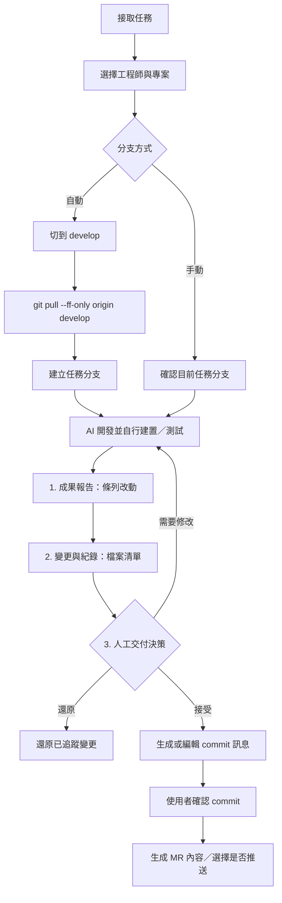

# 🏢 PixelOffice — 協作控制面板

一個架設在 **本地端 (localhost)** 的 **RPG 風格 AI 協作控制面板**。
透過像素風辦公室介面，管理 1 位 PM Agent 與多位工程師 Agent（預設 3 位），
並讓工程師 Agent 在背景執行 **Claude Code CLI**（`claude`）或 **OpenAI Codex CLI**（`codex`）自動開發、修改程式碼與跑測試。

## 選擇 AI 平台：Claude Code / OpenAI Codex

在右上角 **設定 → AI 平台** 選擇平台並儲存，不需重新啟動服務。預設為 Claude Code，既有工程師設定繼續有效。

- 新任務使用所選平台；執行中及已完成任務的回饋沿用原平台與原對話。沒有平台欄位的舊任務視為 Claude。
- **工程師** 分頁依所選平台編輯模型。Claude 的 `model` 與 Codex 的 `codexModel` 分別保存，切換不會互相覆蓋；留空使用該 CLI 的預設。
- 頂列顯示目前平台及 real / mock 模式；**連線測試**使用所選平台。Commit / MR 草稿使用任務原平台。
- 平台選擇保存於 `config/ai.json`（可用 `AI_CONFIG` 指定位置），優先於 `.env` 的 `AI_PROVIDER`。取消設定不會套用草稿。

### 使用 Codex

以啟動 PixelOffice 的同一個作業系統帳號安裝並登入 Codex CLI：

```sh
npm install -g @openai/codex
codex login
codex --version
```

`.env` 可設定 `CODEX_BIN=codex`（或執行檔絕對路徑）。全域執行模式只有 Mock / Real，可在「設定 → 執行模式」統一切換 Claude、Codex 與 Jira；`.env` 的 `PIXEL_OFFICE_MODE` 只是未從畫面覆寫時的預設值。Codex 使用自身登入，PixelOffice 不儲存登入憑證。

### Codex 相容層與驗證

Codex 整合使用 App Server 的 stdin JSON-RPC 接口，支援啟動、續跑、工具事件、回合完成及模型查詢。工單與模型參數不進 shell 命令列。AI 權限模式可選「要求核准」、「代我核准」或「完整存取」；Codex 分別對應 `workspace-write + on-request + user`、`workspace-write + on-request + auto_review` 與 `danger-full-access + never`。連線測試與草稿生成維持唯讀。Codex 未回傳美元成本時不顯示推估費用。

執行 `npm test` 可跑完整回歸測試。

---

## 技術文件

[辦公室 UI 技術實作](OFFICE_UI_TECHNICAL.md)：版型、Canvas 與文字分層、人物素材、尋路與狀態機、編輯器、完整縮放、測試與擴充方式。

## ✨ 功能

**頂列 — 狀態列**
- 連線狀態、目前 AI 平台與全域 Mock / Real 模式一眼可見。
- 右側 **⚙ 設定** 可直接在畫面上增刪「專案」與「工程師」，存檔會同步寫回 `config/projects.json` / `config/engineers.json`。

**辦公室分頁 — AGENT STUDIO**
- 像素場景使用原生 640px 畫布，依面板可用寬高等比例縮放，完整顯示辦公室；人物名稱與任務標籤由獨立 HTML 文字層呈現，避免跟著圖像縮放變糊。
- 右下角是 PM 獨立辦公室，包含隔間、門口與桌椅。**點擊 PM** 直接開啟 Jira 待辦清單，可切換「輸入單號」；移動或旋轉 PM 辦公桌時，人物、椅子、名稱及點擊範圍會一起更新。
- 在「編輯辦公室」可自訂辦公室名稱（最多 30 字元）與 PM／BOSS 名稱（最多 12 字元）。辦公室名稱與家具配置保存在目前瀏覽器；PM／BOSS 名稱存到伺服器（`config/roles.json`），所有人看到的都一樣。
- 「角色外觀」可替 PM、BOSS 與每位工程師挑膚色、髮型、服裝、髮色（8 種）與配件（領帶、眼鏡、耳機，可同時配戴），或按「隨機」直到滿意，「恢復預設」回到自動產生的外觀。外觀存到伺服器（PM／BOSS 在 `config/roles.json`，工程師在 `config/engineers.json`），所有人看到的都一樣，任務追蹤分頁的頭像也會一起更新。
- 工位區是工程師 Agent（預設 Dev A / Dev B / Dev C，數量與名稱可在 ⚙ 設定 調整）。
- 狀態動畫：`Idle`（尋路散步與停留）／`Working`（走回自己的座位後打電腦與螢幕動畫）。

**左側固定 — 待指派任務看板**
- 已接取但還沒派工的 Jira 單。點卡片開啟指派彈窗；卡片右上角 **✕** 可放棄該單。

**任務追蹤分頁 — 執行對話與驗收**
- **每位工程師一個固定分頁**，同時只顯示一段對話，避免多人同跑時互相擠壓；
  非當前分頁有新輸出時會亮未讀點。
- 分頁內顯示：Jira 單號、標題、即時執行時間、Git 分支、本次花費，以及即時的**對話串**。
- **對話串**不是原始 log，而是解析 `--output-format stream-json` 後的逐輪內容：
  工程師說的話、思考（預設收起、點開展開）、動了哪個工具（`📖 Read` / `✎ Edit` /
  `▶ Bash`…，點開看完整參數）、工具回了什麼、最後的輪數與成本。
- 「🚀 送出工單」點開可以看到**實際送進 claude 的指令與完整工單內容**。
- 執行中會出現 **■ 中止** 鈕（見下方「中止任務」）。

**回報分頁**
- PM Agent 的即時通知：接取結果、開始處理、完成驗收提醒等（重新整理後仍看得到歷史）。

**工作日誌**
- 分頁列最右邊的「工作日誌」直接開啟 BOSS 的工作日誌視窗，不會切換目前的畫面；點辦公室裡的 BOSS 或 BOSS 辦公桌也能開啟。

---

## 頁面操作流程

- 頂部工作總覽常駐顯示「待指派／執行中／待驗收／需處理」。待指派開啟看板，其餘開啟任務清單，點任務直接進入該工程師的對應執行紀錄。成功完成才計入待驗收；失敗與中止歸入需處理。
- 接單直接進入待辦清單，以「待辦清單／輸入單號」切換方式，不再先經過 PM 選單。查詢或提交期間暫停切換，避免重複操作。

- 桌面（960px 以上）：左側看板固定顯示，右側切換辦公室、任務追蹤、回報，並可開啟工作日誌。面板各自捲動，辦公室高度不再擠壓看板。
- 窄螢幕：頂端增加「待指派」分頁，單次顯示一個完整工作區。接單後自動顯示看板；指派成功後自動切換對應工程師的執行對話。
- 點選辦公室角色或工位會開啟該工程師的任務。切換分頁保留場景、編輯草稿與任務狀態，不會中止執行。
- 角色標籤只顯示待命、執行中、待驗收、執行失敗、已中止與連線中斷；散步、回座、休息僅作為動畫行為。
- `public/css/dashboard-layout.css` 統一管理工作區尺寸、閱讀字級與響應式版型。辦公室會隨視窗、編輯工具列與角色名單變動自動適應可用空間，不需上下或左右捲動查看場景；文字維持獨立字級。
## 🔧 技術棧

- **後端**：Node.js + Express + Socket.io + Axios，用 `child_process.spawn` 控制 `claude` CLI。
- **前端**：`public/index.html` + `public/css/office.css` — Tailwind CSS (CDN) + Vue 3 (CDN) + Socket.io Client。

---

## 🔒 網路綁定

預設只綁 `127.0.0.1`，也就是**只有本機連得到**。

這個服務**沒有任何認證機制**，而且它的功能就是「在指定路徑下執行 claude」——
所以任何連得進來的人都可以改專案路徑、然後讓 AI 在那個路徑下跑。
要改成對外開放（`HOST=0.0.0.0`）之前，請先自己補上認證與網路隔離；
啟動時若偵測到非 loopback 綁定會印出警告。

---

## 📦 前置需求：Claude Code **CLI**

這個專案是用 `child_process.spawn('claude', …)` 驅動的，所以需要一個**可以被 spawn 的
`claude` 執行檔**。

⚠️ **Desktop app 不含 CLI。** 兩者是分開安裝的，只共用 `~/.claude` 這個設定目錄 ——
所以裝了 Desktop app 之後 `claude` 仍然可能不在 PATH 上。先確認：

```bash
claude --version
```

沒反應就裝一個（Windows PowerShell，官方推薦的原生安裝器，會自動背景更新）：

```bash
irm https://claude.ai/install.ps1 | iex
```

也可以用 `winget install Anthropic.ClaudeCode` 或 `npm install -g @anthropic-ai/claude-code`。

**驗證方式**：啟動 dashboard 後開右上角的 **🔌 連線測試** 頁 —— 它會告訴你執行檔在哪、
版本號、目前是 real 還是 mock，並讓你直接跟 claude 說一句話確認。

- 登入用你的 Claude 會員（Pro / Max / Team / Enterprise），**不需要 API key**
- 如果裝好了但 PATH 沒吃到，原生安裝器會放在
  `%USERPROFILE%\.local\bin\claude.exe`，可在 `.env` 用 `CLAUDE_BIN` 指絕對路徑
- Real 模式不會自動退回 Mock；若 CLI 找不到，連線測試會直接顯示錯誤

### 🩺 claude 跑不起來時

| 症狀 | 原因與解法 |
|------|-----------|
| `spawn claude ENOENT`（回傳碼 `-4058`） | PixelOffice 找不到 Claude CLI。先開 🔌 連線測試確認執行檔位置，必要時用 `CLAUDE_BIN` 填絕對路徑。|
| 全域模式顯示 Mock，但 CLI 已安裝 | Mock / Real 不會根據 CLI 自動切換；請到「設定 → 執行模式」選擇 Real。|

**關於 ENOENT**：Windows 的 `where claude` 會一次列出同名的多個檔案，而 npm 全域安裝
會同時放下兩個 ——

```text
C:\Users\<你>\AppData\Roaming\npm\claude       ← 無副檔名，給 POSIX shell 用的包裝
C:\Users\<你>\AppData\Roaming\npm\claude.cmd   ← Windows 真正能執行的那個
```

無副檔名的排在前面，但 Windows 不開 shell 時只認得 `PATHEXT` 裡的副檔名。

現在 `resolveBin()` 會挑第一個副檔名落在 `PATHEXT` 裡的結果。如果還是遇到類似狀況，
`GET /api/diag` 會直接告訴你三個關鍵值，拿它對照最快：

```text
resolvedPath : …\npm\claude.cmd     ← 指到無副檔名的檔案就是這個問題
needsShell   : true                  ← .cmd/.bat 必須是 true
version      : 2.1.266 (Claude Code) ← 這裡有錯誤訊息就代表 spawn 失敗
```

> 走 shell 是**正常且必要**的：`.cmd` 只能透過 shell 啟動。這也正是工單內容一律走
> stdin、argv 只放固定字面值的原因（見〈全域執行模式與 AI 權限〉的警告）。

---

## 🚀 快速開始

### 方式 A：按兩下啟動（推薦，不必開終端機）

| 系統 | 按兩下 |
| --- | --- |
| Windows | `start.bat` |
| macOS | `start.command` |

啟動器會依序做完：檢查 Node.js 版本 → 沒有 `.env` 就從 `.env.example` 複製一份 →
`node_modules` 缺套件才跑 `npm install` → `npm start` → 自動開啟瀏覽器。
重複啟動時不會噴 stack trace，而是提示「已經在執行中」並開啟既有的分頁。

### 方式 B：自己下指令

```bash
# 1. 安裝相依套件
npm install

# 2. 建立 .env（可先直接複製範例，開箱即用 mock 模式）
cp .env.example .env

# 3. 啟動
npm start
# 開啟瀏覽器： http://localhost:3000
```

> 自動開瀏覽器只在環境變數 `OPEN_BROWSER=1` 時發生（啟動器會自己設）。
> `npm start` / `npm run dev` 維持原本行為，`--watch` 重啟時不會一直彈分頁。

### 啟動時常見狀況

| 畫面上看到 | 意思 / 怎麼辦 |
|---|---|
| `[X] 找不到 Node.js` | 這台機器沒裝 Node.js。到 [nodejs.org](https://nodejs.org/) 裝 LTS 版，再按兩下一次。 |
| `[X] Node.js 版本太舊` | 需要 18 以上，到同一個網站裝新版 LTS。 |
| 卡在「正在安裝相依套件」 | 第一次啟動要抓套件，幾分鐘屬正常，別關視窗。失敗多半是網路或 proxy。 |
| `PixelOffice 似乎已經在執行中` | 已經開過一個了。用原本那個視窗即可；若確定沒有，是別的程式占用 3000 埠，在 `.env` 把 `PORT` 改成 3100 之類。 |
| 瀏覽器沒自動開 | 視窗會印出網址，手動開 http://localhost:3000 即可，服務本身是正常的。 |
| macOS 說「來自未識別的開發者」 | 對 `start.command` 按右鍵 →「打開」→ 再按一次「打開」。 |

---

## ⚡ 待辦清單與開單選項的快取

mcp 模式撈一次 Jira 要走 spawn npx → OAuth → 多次 MCP 呼叫，實測 **9～50 秒**。
所以這兩份資料改成**伺服器開機時就在背景先撈好**：

| 資料 | 內容 | 開機預熱 |
|---|---|---|
| 待辦清單 | 最新進行中 Sprint 的待辦未指派任務 | ✅ |
| 開新單選項 | 父系候選、議題類型、Sprint 清單 | ✅ |

之後點「待辦清單」或「開新單」都是讀快取，**幾十毫秒**就開。兩個面板右上角
會顯示「資料取得於 HH:MM」，旁邊的 **↻ 重新整理** 按鈕才會真的重打 Jira。

刻意**不做定時自動更新** —— 什麼時候該拿新資料由你決定，畫面上的時間戳讓你自己判斷。
會自動失效重撈的只有一種情況：在設定裡改了 Jira 模式或看板 ID（那份快取已經是別人的資料）。

其他行為：

- 任務的**本地狀態不進快取**，每次都重算，所以剛接取的單不會在清單上顯示成還沒接。
- 同時多個請求只會真的打一次 Jira，後到的共用同一個結果。
- 開機預熱失敗（例如當下沒網路）不會擋住伺服器啟動；下次點開時會自動重試。
- API 想自己帶參數的話：`GET /api/jira/tasks?refresh=1`、`GET /api/jira/card/options?refresh=1`；
  `GET /api/jira/cache` 可查兩份快取目前的狀態。

---

## 📥 Jira 資料來源

| 全域模式 | Jira 行為 |
|-------------|------|
| `Mock` | 使用內建假任務（JIRA-101~104），不連線 Atlassian。|
| `Real` | 固定透過 Atlassian Rovo MCP Server 取單與建單。`server.js` 會啟動 `mcp-remote`，以 JSON-RPC 呼叫 Atlassian MCP 工具。|

### 撈單範圍：最新進行中的 Sprint 的「待辦」未指派任務

不設定 `JIRA_JQL` 時，系統會自動組出：

```
[project = "XXX" AND] sprint = <最新 active Sprint ID> AND statusCategory = "To Do" AND assignee is EMPTY ORDER BY created DESC
```

- `sprint = <ID>` — 先從 `JIRA_BOARD_ID` 看板取得所有 active Sprint，取開始日期最新者；同日期以 ID 降冪決定。
- `statusCategory = "To Do"` — 只看**待辦欄位**的單（排除進行中與已完成）
- `assignee is EMPTY` — 只看**未指派**

> 用 `statusCategory` 而不是 `status`，是因為各團隊的狀態名稱可能是「待辦」「To Do」「Open」「Backlog」不一而足，
> 但 `statusCategory` 是 Jira 標準化的三大類（To Do / In Progress / Done），不會因為命名差異而漏撈。

| 變數 | 用途 |
|------|------|
| `JIRA_BOARD_ID` | 必填。選定看板，取其中開始日期最新的 active Sprint。|
| `JIRA_PROJECT` | 選填。填專案代號（如 `ABC`）進一步限定範圍。|
| `JIRA_JQL` | 選填。額外篩選，不能覆寫 Sprint 與待辦、未指派條件。|
| `JIRA_DEBUG` | 設 `true` 會在終端機印出 Jira 原始回應，方便比對標題。|

實際送出的 JQL 會顯示在接取彈窗底部，隨時可以核對。

> **關於任務標題**：標題一律**逐字照搬 Jira 卡面的 `summary`**，不做任何改寫、截斷或補字。
> 程式只讀 `fields.summary`，不會退而抓其他欄位（例如 `title`）湊出標題；卡片若真的沒有標題就顯示空白，只留卡號。

### ⚠️ 使用 MCP 模式前，先完成一次性 OAuth 授權

Atlassian 遠端 MCP 需要 OAuth。請**先在終端機手動跑一次**，會開瀏覽器讓你登入 Atlassian
（URL 有 `?`，記得加引號）：
```bash
npx mcp-remote@latest "https://mcp.atlassian.com/v2/mcp?tools=all"
```
授權成功後，token 會快取在 `~/.mcp-auth`，之後 `server.js` spawn 時即可免互動使用。
（若想先看 UI，在「設定 → 執行模式」選擇 Mock 即可。）

> **token 是「綁 URL」的。** mcp-remote 用 **server URL 的 md5** 當目錄名，
> 所以 `…/v1/mcp` 和 `…/v2/mcp?tools=all` 是兩份獨立授權 ——
> 改了 `JIRA_MCP_URL` 就等於換一個全新、未授權的 server，得再跑一次上面的指令。

**確認授權成功**：`~/.mcp-auth/mcp-remote-v1/` 底下要出現對應的 `…_tokens.json`。
只有 `_client_info.json` 和 `_code_verifier_*.txt` 代表授權**開始了但沒完成**。
對照方式：

```bash
node -e "console.log(require('crypto').createHash('md5').update(process.env.JIRA_MCP_URL).digest('hex'))"
```

### 🩺 MCP 連不上時

| 症狀 | 原因與解法 |
|------|-----------|
| `MCP 請求逾時：initialize` | OAuth 沒完成。dashboard 把 stdio 全部 pipe 走，授權連結進不了瀏覽器，mcp-remote 就一直等到 90 秒逾時。**先停掉 dashboard**，在終端機手動跑上面那行完成授權，再重啟。|
| `MCP 未回傳任何可存取的 Atlassian 站台` | 授權過了但站台清單沒被解析出來。通常是端點換版、回傳格式改了；`unwrapEnvelope()` 已處理 v2 的 `{ data: … }` 外層與 `resources` 鍵名。若又出現，把 `getAccessibleAtlassianResources` 的原始回應印出來對照。|
| `請設定 JIRA_BOARD_ID` | `.env` 的 `JIRA_BOARD_ID` 沒填。看板網址 `…/boards/197` 的那個數字。|
| `MCP 未提供 listJiraBoardSprints` | 端點工具清單不完整。URL 要帶 `?tools=all`。|
| 終端機只看得到啟動訊息，沒有進度 | 正常。`[mcp]` 開頭的細節是透過 Socket.io 的 `mcp:log` 送到**瀏覽器面板**，不會印在終端機。|

> 第一次連線要 `npx` 下載 `mcp-remote`，握手可能要十幾秒到一分鐘。
> 撈到 0 筆是合法結果（該 Sprint 沒有「待辦 + 未指派」的單），清單會是空的但不會報錯。

---

## ⚙️ 全域執行模式與 AI 權限

編輯 `.env`：

| 變數 | 說明 |
|------|------|
| `PIXEL_OFFICE_MODE=mock` | 全部使用模擬資料，不執行 AI CLI、不連線 Jira。|
| `PIXEL_OFFICE_MODE=real` | 所選 AI 平台執行真實 CLI，Jira 固定使用 Atlassian MCP。|
| `AI_ACCESS_MODE=ask` | 要求核准；敏感操作送回 PixelOffice 逐次確認。|
| `AI_ACCESS_MODE=auto` | 代我核准；使用 AI 原生審核並保留工作區 sandbox（預設）。|
| `AI_ACCESS_MODE=full` | 完整存取；不詢問且解除 sandbox，只應用於可信任的隔離環境。|
| `CLAUDE_BIN` | `claude` 執行檔路徑或指令名稱（不在 PATH 內時可填絕對路徑）。|
| `WORKSPACE_DIR` | 沒有設定專案、或指派時沒選專案時，退回使用的預設工作目錄。|
| `AUTO_GIT_BRANCH` | 舊設定已不控制派工；每次派工需選擇手動或自動分支。|

> ⚠️ Real 模式下的呼叫方式是 **argv 放固定指示句、工單內容走 stdin**：
>
> ```
> claude -p "<固定指示句>" --permission-mode <dontAsk|auto|bypassPermissions> --output-format stream-json --verbose
>
> 固定指示句 = 依照 stdin 傳入的工單內容完成這個任務，修改完成後請執行專案內的單元測試確認功能正常
> ```
> 工單的標題與描述從 stdin 餵進去（這是 Claude Code 文件的用法：
> `cat build-error.txt | claude -p '解釋這個錯誤'`）。
>
> 這條界線不是實作細節，不要移動它：Windows 上 `claude` 是 `.cmd`，只能透過 shell 啟動，
> 而 Node 在 `shell: true` 下不會轉義參數。工單描述若放進 argv，描述裡的 `&` 會變成
> 可執行的命令、換行會讓命令在該處被截斷（連 `--dangerously-skip-permissions`
> 都送不到，claude 於是卡在互動式權限詢問永不結束）。
> argv 上只能放程式裡寫死、不含引號與 shell 元字元的常數。
>
> 工程師已移除略過權限的參數。PreToolUse hook 會把工具名稱與完整參數送到控制面板，只有「允許這一次」才放行；拒絕、服務無法連線或五分鐘逾時均不核准。

---

## 🔄 運作流程（接取 → 刊版 → 指派）

### Ponytail 開發原則

PixelOffice 會在工程師的開發任務提示中加入 [Ponytail](https://github.com/DietrichGebert/ponytail) 的精簡改動原則：先檢查現有程式、框架功能與相依套件；優先重用或修正現有實作；只為目前需求增加必要程式；完成前檢查差異並如實回報測試結果。一般指派、自動開發及驗收後要求修改都會套用，Claude Code 與 Codex 都適用。

這是 PixelOffice 內建的**提示整合**，不需另外安裝 Ponytail CLI 外掛，也不提供外掛的 `/ponytail` 模式切換或指令。規則位於 `src/server/ponytail-guidance.js`；修改後需重啟 PixelOffice，新開始的任務才會使用新版提示。它不會改變專案的權限核准、測試要求或人工驗收流程。

1. **點 PM**（或看板上的「＋ 接取 Jira 任務」）→ 直接開啟待辦清單，
   彈窗上方以 **「待辦清單／輸入單號」** 切換兩種取單方式：
   - **待辦清單** — 列出最新進行中的 Sprint 中所有未指派的任務，勾選後**批次接取**（可多選）。
   - **輸入單號** — 直接輸入單號（例如 `DEMO-123`，可用逗號／空白／換行一次輸入多筆），
     系統會先向 Jira 查回該卡的**真實標題**確認存在，才放進刊版。
     此方式**不受 Sprint 與未指派條件限制**，適合處理指定的舊單或跨 Sprint 的單。
     查不到的單號會留在輸入框並標示，方便修正後重送。
2. **接取後**：後端把每張工單內容存成 `task/<卡號>/task.json`（MCP 模式會在此時補撈完整描述）
   → 出現在左側 **待指派任務看板**。刊版每張卡右上角有 **✕** 可放棄（會二次確認；
   只移除本地刊版與 task 檔，Jira 上的單不受影響，之後可再接取回來）。
3. **指派**：點刊版上的任務卡 → 選一位 `Idle` 工程師 + 選一個專案（會自動預選第一個未被佔用的專案，可手動改）→
   「開始執行」。後端會：
   - 依 `config/projects.json` 找到專案路徑，依使用者選擇保留手動切好的分支，或在逐次核准後建立／切換指定分支。
     **分支開不成功（已存在／不是 git repo／工作區有未提交變更）時，`real` 模式會直接中止任務**，
     不會讓 AI 在當前分支（很可能是 `main`）上動手；`mock` 模式不改檔案，所以只警告；
   - 為該工程師開一條專屬管道，`spawn` `claude` CLI（工程師從 `task/` 讀單執行）；
   - `stdout` 經 Socket.io 即時串流到右上該工程師的 **執行中任務** 分頁。
4. **完成**：工程師轉回 `Idle`，`task/<卡號>/task.json` 狀態更新為 `done`，PM 在右下發布：
   > 「[JIRA-XXX] 任務已由 Dev A 完成並跑完測試！請您進行 Code Review 與最後驗收。」
   （PM 不做 Code Review，只提醒驗收。若 CLI 回傳碼非 0，狀態記為 `failed`，PM 會提醒先看 Terminal Log。）

---

## ⏹ 中止任務

執行中的任務在對話面板右上角有 **■ 中止**，按下會二次確認。中止後：

- 整棵程序樹被結束（Windows 上用 `taskkill /T`；`proc.kill()` 只會殺掉 shell，
  真正在跑的 node 程序會變孤兒繼續改你的檔案）
- 工程師回到 `Idle`，專案鎖釋放
- **該單退回刊版可以重新指派** —— 不會變成既不在刊版也不在執行中的孤兒
- 自動分支模式重派時，若分支已存在，會先請使用者核准，再切回該分支；手動模式不代為切換。

## ✅ 驗收流程

### Jev 小助手（實驗性）

在「檢查成果 → Jev 小助手」按 **開始檢查**，系統會讀取本地保存的 Jira 任務單，以及任務分支目前可見的 Git 差異與未追蹤檔案，送至 [TypeSafe Jev API](https://docs.typesafe.ai/introduction/quickstart) 評估。這是手動呼叫的外部 API，可能產生費用，也會將上述內容送給 TypeSafe。

Jev 是**選配模組，預設關閉**。到「設定 → 🧩 功能模組」勾選 **Jev 小助手** 並儲存後，「檢查成果」才會出現 Jev 小助手分頁，連線測試頁也才會顯示 Jev 連線測試；取消勾選即隱藏，立即生效、不需重啟。也可在 `.env` 設 `JEV_ENABLED=on` 當開機預設值（畫面上的設定優先）。模組關閉時，Jev 的 API 也會拒絕呼叫。

**設定 Jev：**

1. 在 [TypeSafe 控制台](https://console.typesafe.ai/)取得 API key。
2. 打開 PixelOffice 根目錄的 `.env`，新增或填入 `TYPESAFE_API_KEY=你的金鑰`。保留在本機，不要把金鑰提交到 Git。這個金鑰只供 Jev 使用，與 Claude／Codex 的登入和模型設定分開。
3. 重啟 PixelOffice。到頂列 **🔌 連線測試**，在「Jev 連線測試」按 **測試 Jev**。只要已設定金鑰，無論 PixelOffice 是 Real 或 Mock 模式，都會送出一個簡短問題呼叫真實 API，顯示連線成功或錯誤。Mock 模式沒有金鑰時才顯示示範成功；Real 模式沒有金鑰會提示 `TYPESAFE_API_KEY`。

連線成功後，再到真實任務的驗收頁使用 Jev 小助手。連線測試只驗證 API 有回應，不代表對任務品質的評分一定正確。

評估五項：**需求正確性、安全性、穩定性、測試品質、可維護性**。Jev 對每項回傳 0–1 的判定值；系統以 0.5 為界轉成「通過／未通過」，通過得 20 分、未通過得 0 分。總分達 **80/100** 顯示「達參考門檻」。Jev 不產生文字審查報告，也不執行程式或測試。結果只供使用者參考，**不會自動通過或阻擋人工驗收**。

Mock 任務按「開始檢查」會顯示固定的 **80/100 示範結果**（四項通過、一項未通過），不讀取程式差異、不呼叫 Jev API，也不需要 API 金鑰；畫面會標示「Mock 示範結果」。真實任務若沒有改動、分支不符或證據超過 100 KB 則不評分；若任務記錄了基底 commit，會連已提交改動一起比較，否則以目前 HEAD 為基準。若在檢查後又修改程式，請按「重新檢查」。

任務執行完（`done` / `failed`）之後，對話面板上方會出現**驗收面板**：

1. **看變更** —— 列出該專案所有尚未 commit 的檔案（含未追蹤的新檔）與 `git diff --stat`，
   並顯示目前在哪條分支、是否就是這張單的分支。
2. **你自己 commit** —— 這是刻意的設計：要 commit 什麼、訊息怎麼寫，由你決定，系統不代勞。
3. 兩個出口：
   - **驗收完成** → 僅限 `done`，確認後狀態變 `accepted`，這張單結案
   - **要求修改** → 見下方；`failed` 任務只能先處理失敗原因，不能驗收

### 不滿意？把意見送回給同一個工程師

驗收面板有一個輸入框。送出後系統會用 `claude -p ... --resume <session_id>`
**接續原本那一段對話**，所以 AI 記得它剛才讀過哪些檔案、改了什麼、為什麼那樣改，
不需要從零重新理解一次。

- 沿用同一個 `cardId`，新對話接在原本那一串後面，你看到的是連續的紀錄
- 你的意見會以「你的驗收意見」出現在對話裡
- 修完之後狀態回到 `done`，可以再驗收一次 —— 這個迴圈可以重複

> `session_id` 是執行時從 stream-json 收下來、存進 task JSON 的。
> 舊資料或太早失敗的單沒有 session id，那種情況只能從刊版重新指派。

## 🧹 派新單前的工作區檢查

因為 commit 是你的職責，系統負責**確認你做了**：`real` 模式下派新單時，
如果專案還有未提交的變更就會擋下來，並列出是哪些檔案。

不擋的話會發生這件事（實測）：

```
第 1 張 JIRA-101 → checkout -b feature/JIRA-101 → AI 改了 app.js（沒 commit）
第 2 張 JIRA-102 → checkout -b feature/JIRA-102 → 成功，但 app.js 的變更被帶過來了
兩條分支都指向 init，diff 裡兩張單的變更混在一起，沒辦法分開驗收
```

指派彈窗會列出未提交的檔案，並提供「我知道，仍要繼續」—— 要不要冒這個險由你決定。

| 端點 | 用途 |
|------|------|
| `GET /api/tasks/:key/review` | 該單所屬專案目前的變更、分支、能否送回饋 |
| `POST /api/tasks/accept` | 標記完成，body：`{ key }` |
| `POST /api/tasks/feedback` | 送驗收意見接續原對話，body：`{ key, message }` |
| `POST /api/assign` | 多了 `force: true`，可無視工作區不乾淨 |

## 💾 對話落地與回放

每個對話事件都會即時寫進 `task/<卡號>/log.jsonl`（一行一個 JSON），所以：

- **瀏覽器重整**：執行中任務的對話會完整重播回來（以前重整後畫面是全白的）
- **伺服器重啟**：最近結束的任務仍會出現在分頁上，點進去就看得到當時的完整對話
- 「整理已結束任務」會把失敗任務退回待指派，已驗收紀錄封存，待驗收任務保持可見；更新由後端保存並同步所有連線。舊版已隱藏的失敗任務也可重新接取，事件檔仍保留。

| 端點 | 用途 |
|------|------|
| `GET /api/tasks/:key/events` | 取回某張工單的對話事件（`?limit=N`，上限 2000 筆） |
| `POST /api/tasks/abort` | 中止執行中的任務，body：`{ cardId }` |

> 回報目前仍只存在記憶體（最近 80 條），伺服器重啟就會清空。
> 對話本身有落地，PM 訊息還沒有。

---

## 🗂️ 設定檔：專案與工程師

兩份設定檔都可以**直接在畫面右上角的 ⚙ 設定 修改**，按「儲存」會同步寫回檔案；也可以手動編輯。

> **`config/` 下由畫面寫入的四份都是個人環境設定，不進版控**：`projects.json`（含你的本機路徑）、
> `engineers.json`（你的工程師名單與模型）、`runtime.json`（畫面對 .env 的覆寫，含看板 ID）、
> `ai.json`（選用的 AI 平台）。同目錄有對應的 `*.example.json` 範本可複製。
> 檔案不存在時程式會用預設值，不影響啟動（`engineers.json` 還會自動以 Dev A／B／C 重建）——
> 所以新環境不必先建檔，直接在畫面上設定即可。

### `config/projects.json` — 工程師去哪個專案改程式碼

```json
{
  "projects": [
    { "id": "frontend", "name": "前端專案", "path": "C:/你的/前端專案路徑", "type": "前端" },
    { "id": "backend",  "name": "後端 API", "path": "C:/你的/後端專案路徑", "type": "後端" }
  ]
}
```

- `path` 用正斜線 `/` 或雙反斜線 `\\` 皆可（Windows）。
- `type` 只是給人看的分類標籤（前端／後端／全端／其他），不影響派工邏輯。
- 沒設定任何專案、或指派時沒選專案 → 退回 `.env` 的 `WORKSPACE_DIR`（預設為本專案目錄）。

### `config/engineers.json` — 工程師名單與各自的模型

```json
{
  "engineers": [
    { "id": "devA", "name": "Dev A", "model": "opus" },
    { "id": "devB", "name": "Dev B", "model": "sonnet" },
    { "id": "devC", "name": "Dev C", "model": "" }
  ]
}
```

- **工程師不分類型** —— AI 依工單內容做事，類型標籤放在「專案」上就好。
- 只有名單存在檔案裡；`Idle` / `Working` 這類執行期狀態放記憶體，重啟即重置。
- 執行中的工程師無法刪除。

#### `model`：每位工程師配自己的模型

留空 = **不加 `--model`**，跟著 `claude` CLI 自己的預設走。填了就會變成
`claude -p … --model <值>`。可以填：

- **別名** `opus` / `sonnet` / `haiku` / `fable` —— 永遠指向該系列最新版本
- **完整 model id**，例如 `claude-haiku-4-5`

難的重構派給 opus、跑雜事的派給 haiku，成本差距很有感 —— 而且因為每個任務本來就是
**獨立的程序、獨立的 session**，不同任務用不同模型天生就成立。

⚠️ 模型名會進命令列，所以只允許英數與 `._@-`。含其他字元（例如 `&`）會被忽略，
並在對話裡留一行警告，不會靜靜地拿掉。

### 模型清單是怎麼來的

`claude` CLI **沒有列出模型的指令**，所以 ⚙ 設定 裡那個下拉是三個來源湊出來的
（`GET /api/models`）：

| 來源 | 需要什麼 | 給你什麼 |
|------|---------|---------|
| 別名 | 不需要 | `opus` / `sonnet` / `haiku` / `fable`，永遠是最新 |
| Anthropic Models API（`GET /v1/models`） | `ANTHROPIC_API_KEY` | 真實清單，含顯示名稱與 context window（快取 1 小時）|
| 實際跑過的 | 不需要 | 從 stream-json 的 `system/init` 事件學到的真 model id |

沒有設 `ANTHROPIC_API_KEY` 也沒差 —— 下拉會只剩別名與跑過的紀錄，而別名本來就夠用。
那個欄位是可自由輸入的（`datalist`），下拉只是建議，完整 id 照樣填得進去。

> ⚠️ **`ANTHROPIC_API_KEY` 預設不會傳進 `claude` 子程序。**
>
> 這件事需要特別處理：`dotenv` 會把 `.env` 灌進 `process.env`，而 spawn 是用
> `env: process.env`，所以「為了撈模型清單而設的 key」會被 claude 繼承 ——
> 而 Claude Code 看到那個變數就會改用它驗證（可能從你的訂閱變成 API 計費）。
> 這個 dashboard 不該偷偷改動 claude 的身分，所以 `claudeEnv()` 會把
> `ANTHROPIC_API_KEY` 與 `ANTHROPIC_AUTH_TOKEN` 濾掉。
>
> 真的想讓 claude 走 API key 才設 `CLAUDE_USE_API_KEY=true`。
> 目前是哪一種，🔌 連線測試頁的「claude 的驗證方式」那一列會直接告訴你。

> 每張單實際用了哪個模型會顯示在任務卡上（🤖）與對話第一行的
> 「claude 已啟動 · <模型>」—— 那是 CLI 自己報的，不是我們寫上去的。

### ⚠️ 併發規則：一個專案同時只能由一位工程師執行

多位工程師可以**同時**工作，但**必須是不同專案**。

| 情境 | 結果 |
|------|------|
| 工作A→工程師A（專案A）、工作B→工程師B（**專案B**） | ✅ 兩個 Claude 程序完全獨立，各自的 git 分支與 Terminal log 互不干擾 |
| 工作A→工程師A（專案A）、工作B→工程師B（**同樣專案A**） | 🚫 第二筆會被擋下：「專案A 正由 Dev A 執行 WORK-A，請等該任務完成後再指派」 |

**為什麼要擋？** 任務在共用的專案路徑下執行 `claude`，自動分支模式還會在核准後切換分支。
若兩個任務指向同一個資料夾，後啟動的那個會把 working tree 切到自己的分支，
讓前一個 AI 在錯誤的分支上繼續改檔，兩者還會同時編輯同一批檔案。
（鎖是以**解析後的絕對路徑**為鍵，所以兩個 id 指到同一路徑也擋得住。）

指派彈窗會把使用中的專案標成 🔒 並 disable，顯示佔用者與單號；任務完成後鎖會自動釋放。

接取的工單存放於 `task/` 資料夾（可用 `.env` 的 `TASK_DIR` 改路徑），每張一個資料夾，狀態保存在 task.json，含 `status`：

`backlog`（待指派）→ `in_progress`（執行中）→ `done`（待你驗收）→ `accepted`（你已標記完成）。

另外還有 `failed`（回傳碼非 0，可送回饋或重新指派）；被中止的單會自動退回 `backlog`。

---

## 📁 交付檔案

```text
PixelOffice/
├─ start.bat                  # Windows 一鍵啟動（按兩下）
├─ start.command              # macOS 一鍵啟動（按兩下）
├─ server.js                  # 相容啟動入口
├─ package.json               # npm start / npm dev / npm test
├─ .env.example               # 環境變數範例（.env 不進版控）
├─ config/                    # 專案與工程師設定
│  ├─ projects.json           # 個人環境設定，不進版控（範本：projects.example.json）
│  ├─ runtime.json            # 畫面對 .env 的覆寫，不進版控（範本：runtime.example.json）
│  ├─ ai.json                 # 選用的 AI 平台，不進版控（範本：ai.example.json）
│  └─ engineers.json          # 工程師名單，不進版控（範本：engineers.example.json）
├─ src/server/
│  ├─ app.js                  # Express、Socket.io、任務生命週期
│  ├─ open-browser.js         # 啟動後自動開分頁（OPEN_BROWSER=1 才作用）
│  ├─ features/               # 工程師成果與交付操作
│  ├─ security/               # 核准佇列與 CLI hook
│  └─ integrations/           # Jira MCP 整合
├─ public/
│  ├─ index.html              # 主頁模板
│  ├─ pages/                  # 連線測試、角色檢查頁
│  ├─ js/                     # Vue 工作流程、場景與引擎
│  ├─ css/                    # 各頁與辦公室樣式
│  └─ assets/backgrounds/     # 庭院 SVG
├─ assets/characters/MetroCity/ # 原始角色素材，維持套件內部分類
├─ task/                      # 每單資料夾（Markdown、task.json、log.jsonl），不進版控
├─ test/                      # Node 回歸測試
└─ docs/                      # 使用手冊、技術文件與展示素材
```

設定檔路徑都可用環境變數覆寫：`TASK_DIR`、`PROJECTS_CONFIG`、`ENGINEERS_CONFIG`。

## 像素辦公室

辦公室使用 Canvas 與 `assets/characters/MetroCity` 素材，透過 `/assets/MetroCity` 靜態路徑提供。請保留素材資料夾一起部署。

- `public/js/office-engine.js`：格子尋路、家具碰撞、角色位置預約、任務狀態切換與配置驗證。
- `public/js/office-scene.js` / `public/css/office-scene.css`：Canvas 場景、家具編輯器與 Vue 控制列。
- 待命角色隨機散步、停留；接單後完成當前步伐再回座，工作結束後休息片刻再離座。真實任務由既有 Socket.io 狀態驅動。
- 「動畫試演」只切換角色視覺狀態，不會發送工單或啟動 Claude。
- 「編輯辦公室」可新增家具、移動、按 Q 左轉或 R 右轉、刪除、復原與更換地板。沙發可轉四個朝向；也可新增檔案櫃、印表機、飲水機和會議桌。工作桌需保留；座位和主走道不可被家具堵住。配置儲存於此瀏覽器、此站點的 localStorage，不跨瀏覽器或連接埠同步。
- 預設辦公室包含魚缸（游魚與氣泡動畫）、咖啡機、冰箱、書櫃及沙發休息區。已有自訂配置時，可在編輯器選「預設配置」預覽新版，再按「儲存配置」套用。
- 編輯時角色暫停，後端任務繼續；工程師名單變動會退出編輯，新增工程師會自動取得新工位。
- 系統「減少動態效果」會停止閒逛與走路影格，仍會呈現回座後的工作狀態。失去連線時暫停場景移動。

### 人物穿著

身體、服裝、髮型三層共用同一個影格。每格 32 × 32，四方向各六格。`OfficeEngine.appearance()` 統一場景和右側頭像的搭配規則。

**Outfit1～4 是局部衣物，不可直接當成完整套裝。** 目前只輪替包含上衣與褲裝的 Outfit5、Outfit6；PM 固定使用 Outfit5。新增工程師亦遵守此規則。

可開啟 `/character-check.html` 檢查九組外觀的全部四方向、共 216 個影格。素材來自 JIK-A-4 的 [MetroCity - Free Top Down Character Pack](https://jik-a-4.itch.io/metrocity-free-topdown-character-pack)，以 CC0 1.0 授權釋出；出處與授權見 `assets/characters/MetroCity/LICENSE.md`。

### 驗證

執行 `node --test test/office-engine.test.cjs`，涵蓋完整套裝規則、路徑與碰撞、回座／離座、同時接單、名單變動、減少動態與無效配置。


## 操作確認與重試

- 工程師最多 6 位，前端新增按鈕及後端保存 API 都會限制。
- 每次派工可選手動或自動分支。手動模式請先自行切好；自動模式會在你明確開始任務後，切到設定的基底分支（預設 `develop`）、執行 `git pull --ff-only origin develop`，再建立指定任務分支。Mock 模式不切換 Git 分支。
- 固定且受控的唯讀 Git 查詢（status、diff、log、rev-parse 等）不需核准，避免檢查成果時反覆打斷。會改變 repository 的 checkout、pull、add、commit、restore、push 等仍要核准或由明確啟動的自動分支流程執行。
- 為涵蓋腳本間接呼叫 Git，工程師的所有工具呼叫都會送出確認（因此一般讀檔、改檔及測試也會出現確認）。面板會展示目錄、命令／工具及參數；核准只生效一次，刷新可重新看到待確認項目，中止任務會取消該任務的待確認。
- 這是操作核准流程，不是作業系統沙箱。你允許的腳本可能有多個副作用，請看完整命令；不宣稱可攔截 Claude CLI 自身的啟動行為、既有背景程序或其他應用程式的 Git 操作。
- 實作依據：[Claude Code Hooks](https://code.claude.com/docs/en/hooks) 與 [CLI 參數](https://code.claude.com/docs/en/cli-usage)。核准佇列與 hook 可在沒有 Claude CLI 的環境獨立測試；真實執行路徑則需要在裝好並登入 CLI 的環境做端到端驗證。

新增 API：`POST /api/tasks/clear-finished`、`GET /api/approvals`、`POST /api/approvals/:id`；`POST /api/assign` 必須帶 `branchMode`（manual／auto），自動模式另帶 `branchName`。內部 `/api/tool-approval` 使用每次執行的臨時 token。

預設空間配置：左上入口及水族箱、左中茶水區、中央每排三個工位（六位時兩排），中央下方休息區，右下 PM 隔間朝左開門。

窗戶也可在「編輯辦公室」中配置：選「窗戶」後點上方牆面新增，選取後可移動或刪除，再按儲存。窗戶固定水平 2×1 格，避開左上入口，不支援旋轉，也不影響地板通行。舊配置會自動帶入原本三扇窗戶；刪除並保存後不會重新補回。
家具編輯器新增移動式白板、電視（各 2×1 格）與唱片機（1×1 格），支援新增、移動、旋轉、刪除與保存。預設配置包含三種家具；唱片機目前為視覺裝飾，不播放音樂。
連線測試頁已統一主面板視覺：桌面左側環境診斷、右側測試對話，各區獨立捲動；窄螢幕改為單欄。保留重新偵測、模型選擇、送出、停止與開新對話功能。

### 工程師擴充工具

工程師任務完成或失敗後，面板顯示「檢查成果」入口，集中呈現三個分頁：

1. **成果報告**：工程師完成工作時，系統立即依實際 diff 產生並保存 3～8 點繁體中文摘要；打開檢查成果即可閱讀，不需再按生成。這是閱讀輔助，不代表系統已驗證功能。
2. **變更與紀錄**：只列出與 `git status --short` 相同的變更檔案及狀態，不在此頁展示完整程式碼 diff 或工具紀錄。
3. **交付**：可產生及編輯 commit／MR 草稿。Commit 草稿可直接用「提交變更」按鈕加入全部變更並建立本機 commit，或複製到自己的 Git 工具；MR 草稿只建立文字。提交後可檢查 `origin` 的待推送提交並自行決定是否推送，不需重複輸入 remote 名稱。

「要求修改」與「驗收完成」固定在視窗底部；驗收需再次確認，只有 `done` 任務可驗收。操作失敗時視窗保持開啟。失敗任務可查看原因及送出修改意見，但不能驗收。「捨棄未提交變更」收在交付頁的進階 Git 操作。所有操作使用任務的專案，專案忙碌或分支不符時會拒絕。

- **Commit 草稿**：依 HEAD 到工作目錄的差異生成，也包含未追蹤新檔案；只產**一行純文字**（`<type>(<scope>): 繁中描述`，不含 body 與 Markdown 標記），按「提交變更」仍會分別要求核准 `git add -A` 與 `git commit`。
- **MR 草稿**：填寫目標分支（例如 `origin/main`），依目標分支與 HEAD 的已提交差異生成。第一行是標題，其後的描述固定套用公司模板（功能摘要／主要更改／影響文件／測試說明／相關 Issue），測試核取方塊預設不勾選，相關 Issue 帶入任務單號。只建立文字，不建立遠端 MR。
- **複製內容**：草稿可先修改再複製；只有使用者明確按下「提交變更」才會 commit。
- **還原**：逐次確認 Git 指令後，還原已追蹤檔案及暫存區到 HEAD。未提交修改會遺失，未追蹤檔案保留；確認期間檔案改動會中止操作。
- **推送**：預設遠端為 `origin`，確認畫面顯示遠端位址及分支；只推送指定的已提交版本，不強制推送。

唯讀 Git 查詢直接執行；commit、還原與 push 等寫入指令由交付畫面的明確操作觸發。

Mock 模式的任務不會碰任何 repository：三個分頁與 commit／MR 草稿全部回示範資料，變更清單與交付資訊都會標示「Mock 示範」。「提交變更」「推送」「捨棄未提交變更」在 Mock 下一律拒絕執行並提示切換為 Real 模式。完整 AI 草稿與真實 Git 狀態需要可用的所選 AI CLI 與 Real 模式。

預設工位固定預留六席，兩排各三席、桌面相接且面對面。工程師不足六位時保留空桌椅；新增工程師優先使用空位，不擴大房間。既有自訂配置可在「編輯辦公室 → 預設配置」切換。

目錄用途與修改入口請見 [專案結構導覽](PROJECT_STRUCTURE.md)。

庭院氛圍支援跟隨本地時間或手動選擇早晨（05–11）、中午（11–16）、日落（16–19）、晚上（19–05）。工具列可關閉動態，系統減少動態偏好也會生效；設定保存在此瀏覽器。效果僅覆蓋庭院，室內與文字保持原有亮度。

## 最新 Sprint 與任務檔案

真實查詢必須設定 `JIRA_BOARD_ID`（看板數字 ID）。只選該看板進行中且開始日期最新的 Sprint，再查待辦類別、未指派任務。即使該 Sprint 沒有符合條件的卡片，也不回退上一期。UI 顯示名稱、ID、開始日期；接取後的任務保留 Sprint 快照。

`JIRA_JQL` 現在只作額外篩選，不能覆寫 Sprint、待辦與未指派條件。直接輸入單號仍不受此限制。
MCP 需要完整工具清單中的 `listJiraBoardSprints`，建議端點 `https://mcp.atlassian.com/v2/mcp?tools=all`；工具不可用時會明確報錯。
工具清單與端點依據：[Atlassian 官方文件](https://developer.atlassian.com/cloud/rovo-mcp/guides/supported-tools/)。

每張工單保存：

- `task/ABC-123/ABC-123.md`：標題、需求描述、Sprint、目前狀態與工程師。系統由 JSON 同步產生，請勿直接編輯此衍生檔。
- `task/ABC-123/task.json`：狀態的唯一來源，包含 schemaVersion、status、statusLabel、statusHistory、Sprint、指派、分支、session 與時間戳。
- `task/ABC-123/log.jsonl`：首次執行時建立，後端逐筆追加對話、工具與執行事件，重派／回饋接續累積；沿用既有事件截斷限制。

工程師提示包含 Markdown 絕對路徑與內容快照，要求先讀需求檔再開發。使用自訂專案路徑時也可定位需求。
舊的平面 JSON 與 events.jsonl 在讀取時自動搬入每單資料夾，保留 legacy.task.json 與 legacy.events.jsonl 備份。放棄任務只移除三個系統檔，保留備份與使用者另存的筆記。

共用狀態定義在 `public/js/task-status.js`，後端與 UI 共用中文標籤：

| 狀態 | UI | 意義 |
|---|---|---|
| backlog | 待指派 | 已接取，尚未指派 |
| in_progress | 執行中 | 工程師開發中；相容既有執行卡事件 running |
| done | 待驗收 | 開發完成，等待人工驗收 |
| failed | 執行失敗 | 可重派或提供回饋 |
| accepted | 已驗收 | 人工標記完成 |
| aborted | 已中止 | 執行事件；任務本身退回 backlog |

封存以 `archived: true` 表示，UI 顯示「已封存」，保留 accepted 與歷史紀錄。接取時取得描述失敗會停止接取，避免只存標題後開發。上述為本機工作流程狀態，不會同步修改 Jira 狀態。

## 分配後的自動開發流程

在「設定 → 專案 → 自動開發設定」設定每階段逾時（預設 20 分鐘），以及自動分支起點／MR 目標分支（預設 `develop`）。AI 可執行哪些工具與命令由「設定 → AI 平台 → AI 權限模式」統一控制，不再為每個專案維護命令白名單。



AI 工程師不會自行提交、推送或建立 PR／MR。開發結束後由你在「檢查成果」對話框決定：

1. **成果報告**：工程師完成時，系統依實際差異自動產生並保存條列式改動摘要。
2. **變更與紀錄**：只列出 Git 變更檔案與狀態。
3. **交付**：產生 commit 訊息或 MR 內容草稿；可明確按下 commit、還原或推送，每個寫入動作都要經過核准視窗。

任務目錄只留 workflow-result.json（該輪流程的結束結果）。工程師的一行完成摘要另存於 task.json 的 `resultSummary`，作為成果報告生成時的補充脈絡；畫面上的條列報告仍以實際工作區差異為主。這兩者都不是系統驗證結果。

階段與原因透過 Socket.io 即時更新。blocked 表示需求或權限受阻，interrupted 表示中斷待恢復。面板可補充指示並按「恢復開發」，沿用既有分支與可用 session。伺服器重啟會將未完成狀態轉為 interrupted，不會盲目啟動另一個程序；原 PID 仍存在時拒絕恢復。

自動模式要求乾淨的 Git repository 根目錄與獨立任務分支；TASK_DIR 必須位於被開發 repository 之外。工作目錄必須先乾淨，接著切到基底分支、以 fast-forward only 更新 origin 的最新內容，再建立新任務分支。新任務不會直接沿用同名舊分支。執行期間持續持有專案鎖；中止會停止子程序並保留恢復資訊。

「要求核准」會將操作送回 PixelOffice 核准面板；「代我核准」使用 AI 原生審核並保留工作區 sandbox；「完整存取」不詢問且解除 sandbox。Claude 分別使用 `dontAsk`、`auto`、`bypassPermissions`；Codex 分別使用人工核准、`auto_review` 與 `danger-full-access + never`。完整存取只應用於可信任的隔離環境。

Mock 模式完整展示階段但不修改目標專案。真實 Claude/Jira 連線需以實際帳號另行確認。
